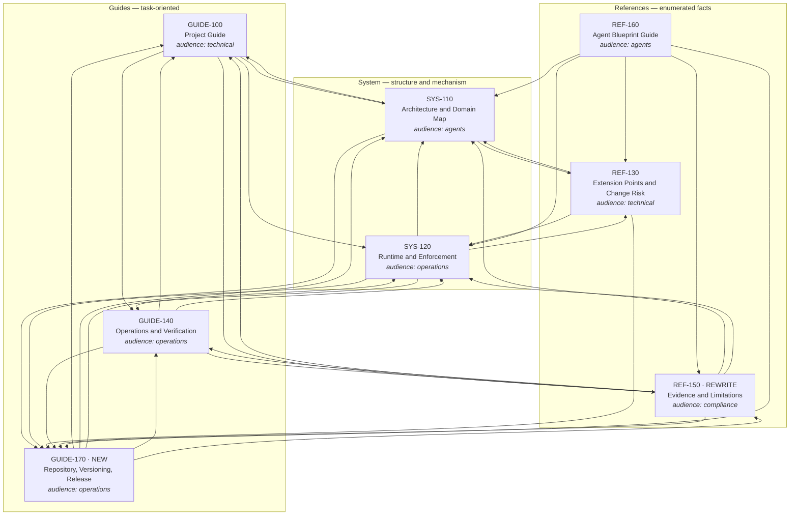
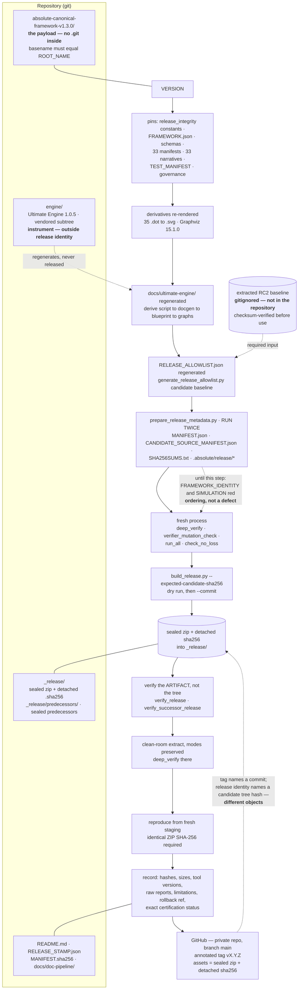

# Outlines — the 1.3.0 documentation set

Architect pass (Opus), 2026-09-07. This is a **schematic, not prose**. The writer (Sonnet)
follows it section by section and supplies the wording; every factual claim it names is
traceable here to a file, a command, or a named derivation.

Read after `FACTS-2026-09-07.md` and `WRITER-BRIEF-2026-09-07.md`. Where this outline and
FACTS disagree, **§0 says which is right and why** — the disagreements were measured in this
session, not assumed.

## Path convention (read this once; the writer must not get it wrong)

| Prefix used in THIS file | Means |
|---|---|
| `PAYLOAD/…` | relative to `absolute-canonical-framework-v1.3.0/` |
| `REPO/…` | relative to the repository root (`Framework-Canonical/`) |

**Inside a governed document, paths are PAYLOAD-relative with no prefix at all**
(`docs/registries/FRAMEWORK.json`, `runtime/verify.py`). GUIDE-170 is the one document that
must also describe REPO-level entries; it names them as *repository root* entries in prose
(`engine/`, `_release/`, `absolute-canonical-framework-v1.3.0/`) and never as an absolute path.
RULEBOOK **L4** treats an internal filesystem path as a leak — no `/Users/...`, ever, in any
document, sidecar, caption or `data_sources.ref`.

---

## §0 — Corrections and additions to FACTS-2026-09-07.md

Measured this session. FACTS remains authoritative for everything not listed here.

| # | FACTS says | Measured reality | Command that settles it | Who must act |
|---|---|---|---|---|
| 0.1 | "Two mutation controls added … and the `structure` section is now wired into that harness" (L38–41) | **Three** controls were added and **two** sections were newly wired. `MUTATIONS` now holds **11** entries; `SECTIONS` holds **6** keys (`identity, structure, governance, representation, runtime, simulation`). The third control is `allowlist_record_removed_while_file_remains` → `ALLOWLIST_RECORD_SET_DRIFT` in section `governance`. | `python3 -c "import ast,sys; …"` over `PAYLOAD/tools/verifier_mutation_check.py`; or `grep -c '^    (' PAYLOAD/tools/verifier_mutation_check.py` → `11` | writer: SYS-120, GUIDE-140, `verification-model.json` |
| 0.2 | New verifier checks are the four `section_structure` codes (L36–38) | There are **nine** new 1.3.0 check codes. Four in `section_structure` (`MODULE_RELEASE_PIN_DRIFT`, `MODULE_NARRATIVE_RELEASE_DRIFT`, `MODULE_NARRATIVE_MISSING`, `FRAMEWORK_REGISTRY_RELEASE_DRIFT`) **plus five in `section_governance`** for the release allowlist (`ALLOWLIST_MISSING`, `ALLOWLIST_RELEASE_DRIFT`, `ALLOWLIST_POLICY_WEAKENED`, `ALLOWLIST_RECORD_SET_DRIFT`, `ALLOWLIST_COUNT_DRIFT`, and the fail path `ALLOWLIST_SCHEMA_VIOLATION` / `ALLOWLIST_SCHEMA_UNCHECKED`). | `grep -n "ALLOWLIST" PAYLOAD/runtime/verify.py` (lines 680–733) | writer: SYS-120 §Cross-representation release pins |
| 0.3 | "Not yet done … `RELEASE_ALLOWLIST.json` regeneration" (L69–72) | **Already regenerated for 1.3.0.** `release_id` = `ABS.RELEASE.1.3.0`, `candidate_id` = `ABS.CANDIDATE.1.3.0`, `record_count` = **1079**, baseline verified against the RC2 tree (`verified_member_count` 849), derivative status counts `PRESERVED_EXACT_FROM_BASELINE` 633 / `MODIFIED_SINCE_BASELINE` 210 / `NEW_SINCE_BASELINE` 229 / `GENERATED_BUILD_CONTROL` 7. **It must be regenerated AGAIN** after the documentation pass, because the pass adds files. | `python3 -c "import json;d=json.load(open('RELEASE_ALLOWLIST.json'));print(d['release_id'],d['record_count'])"` from `PAYLOAD/` | writer (last payload step), per WRITER-BRIEF §9 |
| 0.4 | Payload counts implied by the committed machine layer | The committed `machine/*.json` and every count-bearing figure are **1.1.0 field-trial values**. Measured now: **1079** tracked files (was 1046), `.py` **30** (was 28), `.md` **280** (was 274), `.json` **596** (was 576), `.svg` **39** (was 38), `.dot` **35** (was 34), `.jsonl` **4** (was 1). Domains: `01` 113 (was 112), `04` **133** (was 119), `09` 94 (was 93); the other eight are unchanged. | `git -C absolute-canonical-framework-v1.3.0 ls-files \| wc -l` | writer: every derived figure + `inventory.json` |
| 0.5 | check_no_loss reports "105 requirements" (L58–61) | Both numbers are right and they answer different questions. `docs/registries/CANONICAL_REQUIREMENTS.json` holds **99** (`FRAMEWORK.json` `counts.core_requirements`); `counts.requirements` is **105** = 99 core + `counts.successor_governance_requirements` 6. The current `inventory.json` labels 99 as `canonical_requirements`, which reads as the total. **Rename and add both.** | `python3 -c "import json;print(json.load(open('docs/registries/FRAMEWORK.json'))['counts'])"` | writer: derive-script change D-3 |
| 0.6 | "Engine health on itself … 28 pass / 5 fail / 5 skip" (L80–82) | Confirmed as FACTS states, and it is **not** the number in `machine/evaluation-baseline.json`, which records the 2026-09-01 **engine-on-subject** run: **3 pass / 28 fail / 7 skip**. The two are different measurements of different things and the digits are close enough to be transposed by a careless reader. REF-150 must name both, dated, and never let one stand in for the other. | `cat PAYLOAD/docs/ultimate-engine/machine/evaluation-baseline.json` | writer: REF-150 |
| 0.7 | — (not stated) | `git ls-files` still works from the payload after `.git` moved out. `git -C absolute-canonical-framework-v1.3.0 ls-files` discovers the repo at the parent and lists **payload-relative** paths (first row `.absolute/.lock`). `derive_documentation_model.py`'s `tracked_files()` therefore needs **no change** for the new layout. | `git -C absolute-canonical-framework-v1.3.0 ls-files \| head -2` | writer: no action, but do not "fix" it |
| 0.8 | — (not stated) | `PAYLOAD/.claude/` exists as an **empty, gitignored directory** inside the payload. Empty it is harmless: `ALLOWLIST_RECORD_SET_DRIFT` enumerates `root.rglob("*")` **files** only. The moment any tool writes a file there it is a CRITICAL finding. Same for `.docgen/`, `.health/`, `graphify-out/`, `.docgen_cache.json`. | `git status --short --ignored=matching absolute-canonical-framework-v1.3.0` | writer: hygiene, per WRITER-BRIEF addendum |
| 0.9 | — (not stated) | `PAYLOAD/README.md` still says **1.2.0** throughout (title, release id, candidate id, predecessor). `REPO/README.md` and `REPO/RELEASE_STAMP.json` likewise. FACTS L55–56 assigns these to the orchestrator. **The writer must not edit them** but must not cite them as 1.3.0 evidence either. | `head -5 PAYLOAD/README.md` | orchestrator |
| 0.10 | WRITER-BRIEF cites "FACTS-2026-09-07.md (incl. Addendum 1)" | **No Addendum 1 exists in the file as read** (142 lines, ends at the report-format line). Either it is still to be written or the reference is premature. | `wc -l docs/doc-pipeline/FACTS-2026-09-07.md` → 142 | orchestrator — resolve before the writer starts |
| 0.11 | — (not stated) | `machine/agent-usability-result.json` is a **2026-09-01 field-trial artifact** and is *not written by* `derive_documentation_model.py` (the script writes seven files and *reads* `evaluation-baseline.json`). It is dated history. REF-160 currently cites its red/green passes in the present tense. | `grep -n 'write_json(MACHINE' PAYLOAD/docs/ultimate-engine/scripts/derive_documentation_model.py` | writer: REF-160 |
| 0.12 | — (payload was dirty when FACTS was written) | **The orchestrator committed the payload during this architect pass** as `d647a61` *"framework 1.3.0 (unsealed): version pins, verifier repairs, allowlist repair, predecessor chain"*. `git status --short absolute-canonical-framework-v1.3.0` is now **empty**, so the writer starts from a clean payload and every file it adds is visibly its own. The version-bump surface is therefore an exact diff: **`d647a61` against `3ecedf3`**. | `git log --oneline -2` · `git diff --name-only 3ecedf3 d647a61 -- absolute-canonical-framework-v1.3.0` | writer: §D-7, REF-130, GUIDE-170 |

---

## §A — State of the set, one page

Every one of the seven governed documents carries the identical stale header block:
`last_reviewed: 2026-09-01`, `version: 0`, `revision: 0`, `produced_by: Ultimate Engine
evaluation`, `verified_state: unverified`, `status: review`. All seven were written against a
**foreign subject at release 1.1.0**, laid out as `ChatGPT-Framework-Test/{engine,subject}`.
Nothing in the set names 1.2.0 or 1.3.0.

| doc | stale | wrong | missing |
|---|---|---|---|
| **GUIDE-100** | Header L10–14. "Sources of truth" table (L92–103) predates the cross-representation checks and the allowlist gate. | L101 "`tools/deep_verify.py`, with its real output retained" — no retained output is in the payload. L116–119 `CANNOT_VERIFY` paragraph describes the *documentation pass*, not the release. | The **"Source of truth"** section the orchestrator requires: per fact-kind authority, and how the engine's `artifact-hardened` stamp relates to the framework's own identity model. Nothing anywhere in the set explains that these are two different identity systems. |
| **SYS-110** | Figure `tracked-artifacts-by-domain`/`representation-mix` counts are 1.1.0 (see §0.4). L117–121 "during this exercise" framing. | L123 heading "Repository and runtime boundaries" describes **only** runtime boundaries — there is no repository layout in the document at all. | Repository layout: payload / vendored `engine/` / `_release/` / `.git` **outside** the payload; what is source vs derived. This is the single largest structural change in 1.3.0 and the architecture document is silent on it. |
| **SYS-120** | Enforcement-layers table L97–105 lists six layers; the mutation-checker row says "Each planted mutation is reported as caught" with no count. | L105 "Independent review … absent here" is correct but reads as a defect rather than the designed C20 boundary. | The nine new check codes (§0.2); the three new mutation controls and two newly wired sections (§0.1); **the ordering effect** — why `FRAMEWORK_IDENTITY` and `SIMULATION` are red on a working tree until `prepare_release_metadata.py` runs, and why that is ordering, not a defect. |
| **REF-130** | Figure `dependency-centrality` re-used (values verified unchanged, see §C). | Nothing factually wrong. L101–105 "What not to change here" is still exactly right. | A change route for **"change the release version"** — the one extension the 1.3.0 bump proved is real and undocumented. It routes to GUIDE-170. |
| **GUIDE-140** | L30–31 "The supplied tree's current observed baseline is red in this environment" — 1.1.0-era and now misleading: FACTS L57–61 measures structure/representation/contracts/semantics/security/governance/runtime as **PASS**. | `verification-stack` figure lists four control families but not the **V2 contract validator**, which 1.2.0 wired into `run_all.py` (`tools/validate_v2_contracts.py`, 168 checks). L92 says parity is not proven "unless the environment is pinned" — it *is* now pinned, at Graphviz 15.1.0 (20260618.0150). | The exact release procedure in order; the recorded Graphviz version; mutation liveness as a counted control; the cross-representation pin as a verification family. |
| **REF-150** | Whole document. §"Subject baseline" (L38–55) and §"Subject documentation contradictions" (L57–69) describe defects **1.3.0 fixed**, in the present tense. L64–68 states `framework_release: 1.0.0` vs `1.1.0` and an RC2 test manifest as live findings. | L106–107 "The package does not record a Graphviz version lock beside the derivatives" — **false as of 1.3.0**: `LIMITATIONS.md` L100–107 records 15.1.0 (20260618.0150). L45–47 "the supplied directory is named `subject`" no longer applies; the root is `absolute-canonical-framework-v1.3.0`, matching `ROOT_NAME`. | The RESOLVED/REMAINS split; the allowlist generator's **RC2-tree dependency**, which is a genuine "cannot regenerate from a clone" limitation and appears nowhere; engine self-health as *instrument state*. |
| **REF-160** | L23 "The Stage 5 usability test uses only the artifacts named here" — present tense for a 2026-09-01 event. Routing table L29–35 predates GUIDE-170. | L50–52 describes `blueprint/` scope correctly but omits that `verified` is **0 of 28 nodes** and structurally unreachable (see §F). An agent reading the routing table would not know the completeness report's headline number. | Dated framing for the usability result; what the blueprint pack **cannot** answer. |
| **GUIDE-170** | — | — | **Does not exist.** Everything in §B.8. |

Beyond the eight: `PAYLOAD/docs/ultimate-engine/README.md` (4 of its 6 sentences are still
field-trial framing), `REGENERATE.md` (its entire command block targets a layout that no longer
exists — `subject/`, sibling `engine/`), `system.spec.json` (`system.name` = "Absolute Canonical
Framework **1.1.0**"), `PROJECT_INDEX.json` (all 14 `summary` fields say **1.1.0**; all `created`/
`updated` say 2026-09-01), and the whole `machine/` layer (§0.4).

---

## §B — Per-document outlines

Conventions for every document below:

- **Header block (all eight, identical shape):** `classification: public`, `export_allowed: true`,
  `owner: framework-documentation`, `status: review`, `last_reviewed: 2026-09-07`,
  `produced_by: Ultimate Engine 1.0.5`, `verified_state: unverified`, `version`/`revision` set by
  the `archive cut` the writer performs (WRITER-BRIEF §7). `id`, `title`, `surface`, `audience` per
  document below. **The writer does not stamp.**
- **Source notation:** `[F: path]` = read this file. `[C: command]` = quote this command's output.
  `[D: field]` = produced by `scripts/derive_documentation_model.py`, field named. `[EP: …]` =
  **EVIDENCE-PENDING**, with the command that produces the evidence.
- Sections are listed in final wording. H3s are nested under their H2.

---

### B.1 GUIDE-100 — Absolute Canonical Framework Project Guide · UPDATE

**Purpose.** The one document a newcomer reads first: what Absolute is, what it refuses to claim,
and — new in 1.3.0 — which artifact is authoritative for each kind of fact about it.
**Audience.** `technical` · **surface** `web` · id `GUIDE-100`, title unchanged.

#### H2 `Purpose and boundary`
- Keep the existing three paragraphs (L21–33) — they are accurate and version-neutral. Update only
  "The supplied tree is the framework release" to name the payload directory by its role, not by
  the field-trial word "subject". `[F: PAYLOAD/docs/ultimate-engine/GUIDE-100-project-guide.md L21–33]`
- State the release identity once: `ABS.RELEASE.1.3.0`, candidate `ABS.CANDIDATE.1.3.0`, status
  `RELEASE_INTERNALLY_VERIFIED_INDEPENDENT_CERTIFICATION_PENDING`. `[D: inventory.release_version]`
  `[F: PAYLOAD/docs/registries/FRAMEWORK.json → version, release_id, status]`
- Retain the "does not certify itself" paragraph verbatim in substance: C20 is
  `EXTERNAL_HANDOFF_REQUIRED`, `ABS.CFG.RELEASE.SELF_CERTIFICATION` is fixed to `false`.
  `[F: PAYLOAD/LIMITATIONS.md L5–11]` `[F: PAYLOAD/01_control_plane/manifests_releases/RELEASE_PROCEDURE.md L50–51]`
- Figure `domain-operating-model` sits here, unchanged.

#### H2 `The operating idea`
- Unchanged in substance (L37–51). Authority flows builder → framework → project; feedback informs
  a *future* release and cannot mutate the current one.
- Keep "`absolute next` derives the single permitted action from files" and the read-only-always
  guarantee. `[F: PAYLOAD/runtime/rail.py]` `[D: runtime_model.project_rail]`

#### H2 `Numbered domains`
- Keep the 11-row table (L54–66) — the responsibilities are correct and layer-stable.
- Replace the pointer sentence's implied counts with the derived model. `[D: domain-model.domains[].tracked_files, .canonical_modules]`
- Figure `tracked-artifacts-by-domain` — **derived, re-derived**. The writer must not restate any of
  its 11 values in prose. `[D: figure tracked-artifacts-by-domain]`

#### H2 `Source of truth` ← NEW, required by the orchestrator; replaces the old `Sources of truth`
This is the section that must not be gotten wrong. Six H3s, then the identity-model H3.

##### H3 `Release identity`
- **Authoritative:** `VERSION` (the single string) and the constants it must agree with —
  `RELEASE_VERSION`/`RELEASE_ID`/`CANDIDATE_ID`/`ROOT_NAME` in
  `01_control_plane/manifests_releases/tools/release_integrity.py`.
  `[F: PAYLOAD/01_control_plane/manifests_releases/tools/release_integrity.py L25–35]`
- **Derived from it:** `MANIFEST.json`, `CANDIDATE_SOURCE_MANIFEST.json`, `SHA256SUMS.txt`,
  `.absolute/release/release_identity.json`, `.absolute/release/authority_record.json`,
  `.absolute/release/gate_binding.json` + `gate_evidence/`. All six are written **only** by
  `tools/prepare_release_metadata.py`; hand-editing any of them is how a manifest stops describing
  its subject. `[F: PAYLOAD/tools/prepare_release_metadata.py L3–8]` `[F: PAYLOAD/01_control_plane/manifests_releases/RELEASE_PROCEDURE.md L40–43]`
- **Also derived, and checked against `VERSION`:** `docs/registries/FRAMEWORK.json`
  (`FRAMEWORK_REGISTRY_RELEASE_DRIFT`) and `RELEASE_ALLOWLIST.json` (`ALLOWLIST_RELEASE_DRIFT`).
  `[F: PAYLOAD/runtime/verify.py L271–277, L684–690]`
- The baseline chain is authoritative in `release_integrity.BASELINE_CHAIN` and mirrored in
  `FRAMEWORK.json.baseline_chain`: RC1 → RC2 → 1.0.0 → 1.1.0 → 1.2.0, with 1.2.0 the immediate
  predecessor (`clean_zip_sha256` `cc2a4438…`, `candidate_tree_sha256` `add66854…`). Quote the
  first 8 hex characters only, and say so. `[F: PAYLOAD/docs/registries/FRAMEWORK.json → baseline_chain, predecessor_release]`

##### H3 `Module semantics`
- **Authoritative:** each canonical module package — its `MODULE.md` narrative, `MODULE_MANIFEST.yaml`,
  `requirements.json`, `machine/policy.json`, and fixtures.
- **Derived / index:** `docs/registries/MODULE_INDEX.json` and `AUTHORITY_DEPENDENCY_DAG.json`.
  The index is checked *against the packages*, not the reverse — `MODULE_INDEX_DRIFT` compares the
  set of packages to the set of indexed ids. `[F: PAYLOAD/runtime/verify.py L257–262]`
- 33 modules, 33 manifests, 33 narratives. Do not type these; derive. `[D: inventory.canonical_modules]`
- **New in 1.3.0:** the narrative and the manifest must both name `VERSION`
  (`MODULE_NARRATIVE_RELEASE_DRIFT`, `MODULE_RELEASE_PIN_DRIFT`, `MODULE_NARRATIVE_MISSING`) —
  before 1.3.0 nothing compared the two representations of the same fact.
  `[F: PAYLOAD/runtime/verify.py L199–220]`

##### H3 `Requirements and interfaces`
- **Authoritative:** each package's `requirements.json`. **Derived:** `CANONICAL_REQUIREMENTS.json`,
  which `REQUIREMENT_REGISTRY_DRIFT` reconciles against the union of the packages.
  `[F: PAYLOAD/runtime/verify.py L263–270]`
- Two counts, and they answer different questions: **99** core requirements in the registry;
  **105** total including the 6 successor-governance requirements. Name both, name the difference.
  `[F: PAYLOAD/docs/registries/FRAMEWORK.json → counts]` `[D: inventory.core_requirements, inventory.requirements_total]`
- Interfaces: **31**, authoritative in `INTERFACE_INDEX.json`; a manifest may not declare an
  interface the index does not know (`MODULE_UNKNOWN_INTERFACE`). `[D: inventory.interfaces]`

##### H3 `Verification results`
- **Authoritative:** the *output* of a run, in a named environment, bound to a tree identity —
  never a document's summary of it. `tools/deep_verify.py` derives every result from raw bytes.
- The aggregate entry point is `09_tests_evals/run_all.py`; it invokes the deterministic validator,
  the successor controls, the deep verifier, the mutation check, and the V2 contract validator.
  Any non-zero exit fails the run. `[F: PAYLOAD/01_control_plane/manifests_releases/RELEASE_PROCEDURE.md L62–64]` `[D: verification_model.aggregate_controls]`
- `TEST_MANIFEST.json` is a **description** of that surface, not the surface. It was wrong for two
  releases (field-trial F-06) precisely because nothing validated it against the registry it
  summarised. `[F: PAYLOAD/09_tests_evals/TEST_MANIFEST.json]` `[F: PAYLOAD/CHANGELOG.md → 1.3.0 "The test manifest described a suite that no longer existed"]`
- Delete the old L101 phrase "with its real output retained" — no retained output ships in the
  payload, and the retained-evidence path the 1.1.0 text pointed at
  (`evaluation-evidence/…`) is outside this repository.

##### H3 `Documentation`
- **Authoritative for the framework's own claims:** the payload's root documents and
  `docs/*.md` — `README.md`, `CHANGELOG.md`, `RELEASE_NOTES.md`, `LIMITATIONS.md`, `SECURITY.md`,
  `docs/ARCHITECTURE.md`, `docs/RUNTIME_GUIDE.md`.
- **This set (`docs/ultimate-engine/`) is derived documentation**: it re-expresses the registries,
  the runtime constants and the verifier's own AST. Where it disagrees with a package manifest or a
  canonical registry, **the disagreement is a finding against this set**, not against the tree.
  Keep REF-130's existing statement of this rule and cite it. `[F: PAYLOAD/docs/ultimate-engine/REF-130-extension-points.md L101–105]`
- The `machine/*.json` files are the machine-readable form of this set and are regenerated, not
  edited. `[F: PAYLOAD/docs/ultimate-engine/scripts/derive_documentation_model.py L379–385]`

##### H3 `The two identity systems, and why a hardened stamp is not a release claim`
This H3 is the orchestrator's explicit requirement. It must distinguish, precisely:

- **The framework's identity model** binds *release payload bytes* to a candidate tree SHA-256. Its
  subject is the whole tree; its evidence is `MANIFEST.json` / `SHA256SUMS.txt` /
  `.absolute/release/release_identity.json`; its verdict is a gate binding C0–C20; its terminal
  honest state is `READY_FOR_INDEPENDENT_CERTIFICATION_HANDOFF`, never `CERTIFIED`.
  `[F: PAYLOAD/01_control_plane/manifests_releases/RELEASE_PROCEDURE.md L112–116]`
- **The documentation engine's identity model** binds *one document body* to *one git commit in
  this repository*. Grammar:
  `<!-- artifact-hardened: <STATUS> @ <sha> on <YYYY-MM-DD> via <pass> -->` — kind, a status
  starting uppercase, 7–40 hex, an ISO date, a pass name.
  `[F: REPO/engine/tools/docgen/identity.py L40–47]`
- `artifact-hardened` is the only **drift-sensitive** kind: it certifies *this body, at this
  commit*, so editing the body invalidates it. `[F: REPO/engine/tools/docgen/identity.py L56, L80–82]`
- The header field `verified_state: verified` is the **claim**; the stamp is the **evidence**. A
  document claiming `verified` with no content-certifying stamp is a blocking CRIT finding — "it
  reads as verified forever and for free". `[F: REPO/engine/tools/docgen/identity.py L244–276]`
- **They do not substitute for one another, in either direction.** A stamped document does not make
  the release certified; a verified release does not make any document verified. The framework's
  own C20 stays external regardless of how many documents carry stamps. Say this in one sentence
  and do not soften it.
- State the current honest position: every document in this set carries
  `verified_state: unverified` and no stamp at the time of writing. `[C: grep -n "verified_state" PAYLOAD/docs/ultimate-engine/*.md]`
- Figure `authority-of-facts` sits here (new; §C).

#### H2 `How someone uses it`
- Keep the five numbered steps (L76–87). Update step 1 to name the pinned renderer: Graphviz
  **15.1.0 (20260618.0150)** is the version the release was rendered under and the version a
  verifier must install to reproduce a zero-finding `FRAMEWORK_REPRESENTATION`.
  `[F: PAYLOAD/LIMITATIONS.md L100–107]` `[D: inventory.graphviz_version]`
- Keep step 5's anchor rule verbatim in substance — a local chain detects local edits; only an
  externally surviving anchor detects a full rewrite. `[F: PAYLOAD/LIMITATIONS.md L13–22]`

#### H2 `Documentation relationships`
- Add GUIDE-170 to the dependency prose and keep the existing six links.
  `[D: document_index.documents[GUIDE-100].depends_on]`

#### H2 `What remains unverified`
- Keep the `CANNOT_VERIFY` enumeration but re-scope it: no provider host, remote repository,
  production project, external certifier, or AuditHunt runtime is exercised **by this release's
  package-local suite**. `[F: PAYLOAD/09_tests_evals/TEST_MANIFEST.json → limitations]`
- Point at REF-150 for the full boundary, and say plainly that the 2026-09-01 red findings quoted
  in earlier versions of this set were resolved in 1.3.0 — REF-150 §"What 1.3.0 resolved" is the
  record. `[F: PAYLOAD/CHANGELOG.md → 1.3.0]`

---

### B.2 SYS-110 — Absolute Architecture and Domain Map · UPDATE

**Purpose.** The structural map: what owns what, which direction authority flows, and — new —
how the repository is laid out around the release payload.
**Audience.** `agents` · **surface** `repo` · id `SYS-110`, title unchanged.

#### H2 `Architectural thesis`
- Unchanged (L21–28). Edge direction: consumer → earlier-authority dependency. `[F: PAYLOAD/docs/registries/AUTHORITY_DEPENDENCY_DAG.json → authority_rule]`
- Figure `domain-dependencies` — derived, values **verified unchanged** from 1.1.0: 35 cross-domain
  aggregate edges over 284 module edges, 33 nodes, acyclic. `[D: domain_model.cross_domain_dependencies]` `[C: python3 -c "import json;d=json.load(open('docs/registries/AUTHORITY_DEPENDENCY_DAG.json'));print(len(d['nodes']),len(d['edges']),d['acyclic'])"]`

#### H2 `Repository layout` ← NEW
##### H3 `What each root entry is`
- Four entries, described by role: the **release payload**
  `absolute-canonical-framework-v1.3.0/` (the subject of every integrity control); the vendored
  **instrument** `engine/`; the sealed artifacts `_release/`; the repository's own records
  (`README.md`, `RELEASE_STAMP.json`, `MANIFEST.sha256`, `.gitignore`, `docs/doc-pipeline/`).
  `[F: REPO/docs/doc-pipeline/FACTS-2026-09-07.md L12–25]` `[C: ls -1 <repository root>]`
- **`.git` is outside the payload.** This is the structural change of 1.3.0: `release_integrity`'s
  `FORBIDDEN_PARTS` denylists `.git`, so before 1.3.0 no working tree could pass
  `release_tree_integrity` — only a sealed zip could. `[F: PAYLOAD/01_control_plane/manifests_releases/tools/release_integrity.py L109–112]` `[F: PAYLOAD/CHANGELOG.md → 1.3.0 "Repository layout"]`
- Second consequence, and state it: because tree identity covers everything outside `.absolute/`,
  a `git commit` used to change the work identity. It no longer does. `[F: PAYLOAD/LIMITATIONS.md L50–63]`
- Figure `repository-layout` sits here (new; §C).

##### H3 `What is source and what is derived`
- **Source:** module packages, registries, schemas, fixtures, `runtime/`, `tools/`, root documents,
  `system.spec.json`, `PROJECT_INDEX.json`, the `.dot` graph sources, the authored bodies of the
  eight governed documents.
- **Derived, regenerated, never hand-edited:** the six hash-binding metadata files;
  `RELEASE_ALLOWLIST.json`; every `.svg` (from its `.dot`); `blueprint/*`;
  `docs/ultimate-engine/machine/*.json` (the seven the script writes);
  `docs/ultimate-engine/*_spec.json`; the `.html`/`.json` document builds; `DOCS_INDEX.html`;
  `docs/design/doc-system/CONTENT_INDEX.json`; `graphs/source/*.mmd`, `graphs/rendered/*.svg`,
  `graphs/structure/*`. `[F: PAYLOAD/docs/ultimate-engine/scripts/derive_documentation_model.py L379–385, L525]` `[F: PAYLOAD/docs/ultimate-engine/REGENERATE.md]`
- **The rule that follows:** editing a generated SVG, a machine model, or a publication without
  changing its canonical source is never a fix. Cross-reference REF-130 L22–24 rather than
  restating it. `[F: PAYLOAD/docs/ultimate-engine/REF-130-extension-points.md L22–24]`
- `PROJECT_INDEX.json` is the exception worth naming: an **intentionally maintained registry**, not
  a filesystem scan. `[F: PAYLOAD/docs/ultimate-engine/REGENERATE.md L50–53]`

#### H2 `Semantic containers`
Five H3s, all retained with their current wording as the base: `Kernel`, `Control plane`,
`Capability and knowledge layers`, `Enforcement and tests`,
`Adapters, profiles, optional add-ons, and runtime` (L38–72).
- One change only: the enforcement/tests H3 gains the V2 machine-contract layer under
  `governance/coverage_closure_v3/v2_contracts/`, validated by `tools/validate_v2_contracts.py`.
  `[F: PAYLOAD/CHANGELOG.md → 1.2.0 Added]` `[C: python3 tools/validate_v2_contracts.py]` `[EP: the 168/168 figure is FACTS L60; re-run and quote]`

#### H2 `Interface topology`
- Unchanged (L76–94). Keep the deliberate refusal to duplicate the registry's version and consumer
  lists. `[F: PAYLOAD/docs/registries/INTERFACE_INDEX.json]`

#### H2 `Change risk`
- Unchanged (L98–106). Figure `dependency-centrality` — derived; measured this session as
  **identical** to the 1.1.0 values (AUTHORITY_TRUTH 28, EVIDENCE_GATES 27, CHANGE_RECOVERY 26,
  IDENTITY 26, GOAL_LOCK 25, LIFECYCLE 25, RELEASE/STATE/WORK/DECISIONS 20). The writer re-derives
  and does not type them. `[D: figure dependency-centrality]`

#### H2 `Representations are the architecture`
- Keep the thesis (L110–115). Figure `representation-mix` — derived; **the top-8 membership
  changes**: at equal count 4, `.jsonl` now sorts ahead of `.mmd`, so the eighth bar is different.
  This is exactly the kind of value a writer would carry over by hand. `[D: figure representation-mix]`
- Keep the honest note about `tools.blueprint` deriving only from tracked Python (L117–121) but
  re-scope from "during this exercise" to a standing property, and cross-reference §F's
  measured numbers via REF-160.

#### H2 `Runtime module boundaries` ← renamed from `Repository and runtime boundaries`
- Keep L125–133 unchanged in substance: `absolute` entry point, and the nine `runtime/*.py`
  ownership statements. The repository half of the old heading now lives in `Repository layout`.
  `[C: git -C absolute-canonical-framework-v1.3.0 ls-files 'runtime/*.py']`
- Keep both refusals: the framework refuses to install project state into its own release tree, and
  refuses to write a release artifact inside the tree it describes. `[F: PAYLOAD/runtime/engine.py — the FRAMEWORK_ROOT guard]`

#### H2 `Dependencies`
- GUIDE-100 for the product boundary, REF-130 for change procedure, SYS-120 for runtime order,
  **GUIDE-170 for the repository and release operations that this document only maps**.

---

### B.3 SYS-120 — Absolute Runtime and Enforcement · UPDATE

**Purpose.** What the runtime permits, in what order, and what refuses a wrong move — including
the cross-representation checks 1.3.0 added and the ordering that makes two sections red.
**Audience.** `operations` · **surface** `repo` · id `SYS-120`, title unchanged.

#### H2 `Runtime contract`
- Unchanged (L21–31). Figure `project-rail` — derived from `RAIL_STEPS`. `[D: runtime_model.project_rail]`

#### H2 `Governed document packages`
- Unchanged (L35–52). Figure `document-rail` — derived from `DOCUMENT_STEPS`. `[D: runtime_model.document_rail]`

#### H2 `Mutation order and crash recovery`
- Unchanged (L56–67). Figure `governed-mutation`. Keep the advisory-lock scope sentence exactly:
  serializes on one host, not across hosts on a network filesystem. `[F: PAYLOAD/LIMITATIONS.md L24–29]`

#### H2 `Truth ledger and anchors`
- Unchanged (L71–78). `[F: PAYLOAD/docs/RUNTIME_GUIDE.md §The source of truth]`

#### H2 `Tree identity and staleness`
- Keep L82–93. **Add one sentence** on what 1.3.0 changed in practice: with `.git` outside the
  payload, ordinary version-control activity no longer invalidates evidence bound to the work
  identity. The deliberate no-exclusion-list design is unchanged. `[F: PAYLOAD/LIMITATIONS.md L56–63]` `[F: PAYLOAD/CHANGELOG.md → 1.3.0 "Repository layout"]`

#### H2 `Cross-representation release pins` ← NEW
##### H3 `One fact, four representations`
- The release version exists in `VERSION`, in each `MODULE.md` front matter (`framework_release`),
  in each `MODULE_MANIFEST.yaml`, and in `docs/registries/FRAMEWORK.json`. Before 1.3.0 nothing
  compared them, and all 33 narratives sat two releases behind their manifests (F-05).
  `[F: PAYLOAD/runtime/verify.py L193–220 incl. the in-source comment]` `[F: PAYLOAD/CHANGELOG.md → 1.3.0 Fixed]`
- The four `FRAMEWORK_STRUCTURE` codes, each with what it compares:
  `MODULE_RELEASE_PIN_DRIFT` (manifest vs `VERSION`), `MODULE_NARRATIVE_MISSING` (the narrative
  exists at all), `MODULE_NARRATIVE_RELEASE_DRIFT` (narrative front matter vs `VERSION`),
  `FRAMEWORK_REGISTRY_RELEASE_DRIFT` (`FRAMEWORK.json` `version` **and** `release_id` vs `VERSION`).
  `[D: verification_model.framework_sections_in_execution_order[structure].check_codes]`
- The helper is `_front_matter()` at `runtime/verify.py` L77. Name it; a reader auditing the check
  needs the entry point. `[F: PAYLOAD/runtime/verify.py L77]`
- Adjacent and in the same section: `FRAMEWORK_COUNT_DRIFT` re-derives `FRAMEWORK.json`'s
  `counts.modules/interfaces/core_requirements/profiles/adapters` from the tree. `[F: PAYLOAD/runtime/verify.py L278–292]`
- Figure `cross-representation-pin` sits here (new; §C).

##### H3 `The release allowlist, and why it is now read`
- `RELEASE_ALLOWLIST.json` declares an exact, fail-closed record set
  (`policy: EXACT_RECORD_SET_FAIL_CLOSED`). In 1.2.0 it still declared RC3 and held 879 records
  against a 1,079-file tree, because its generator could no longer run and **nothing read the
  file**. `[F: PAYLOAD/runtime/verify.py L676–679 comment]` `[F: PAYLOAD/CHANGELOG.md → 1.3.0 "The release allowlist was RC3's"]`
- The `FRAMEWORK_GOVERNANCE` codes: `ALLOWLIST_MISSING` (CRITICAL), `ALLOWLIST_RELEASE_DRIFT`
  (release_id/candidate_id vs `VERSION`, CRITICAL), `ALLOWLIST_POLICY_WEAKENED` (CRITICAL),
  `ALLOWLIST_RECORD_SET_DRIFT` (recorded set vs `root.rglob("*")` files, `__pycache__` excluded,
  CRITICAL), `ALLOWLIST_COUNT_DRIFT`, and `ALLOWLIST_SCHEMA_VIOLATION` /
  `ALLOWLIST_SCHEMA_UNCHECKED`. `[F: PAYLOAD/runtime/verify.py L680–733]` `[D: verification_model…[governance].check_codes]`
- **The operational consequence, stated for the reader:** any file added anywhere in the payload —
  a build output, an archive cut, a stray run log — is an unrecorded file and a CRITICAL finding
  until the allowlist is regenerated. `[F: PAYLOAD/runtime/verify.py L700–712]`

##### H3 `The mutation controls that keep these checks alive`
- A clean deep-verify pass is consistent with two situations: every check ran and found nothing, or
  a check silently stopped running. `tools/verifier_mutation_check.py` distinguishes them by
  planting one known defect at a time in a throwaway copy and requiring the named code to appear.
  `[F: PAYLOAD/tools/verifier_mutation_check.py L1–19]`
- **11** mutations across **6** wired sections; 1.3.0 added three
  (`narrative_release_pin_drifts_from_manifest_and_VERSION`, `manifest_release_pin_drifts_from_VERSION`,
  `allowlist_record_removed_while_file_remains`) and newly wired **`structure`** and
  **`governance`**. Derive all of it. `[D: verification_model.mutation_controls]`
- Name the design detail that makes it honest: the harness imports the **mutated** copy, so a
  mutation to runtime code is the code under test rather than the code doing the testing; a
  mutation that crashes the verifier counts as undetected. `[F: PAYLOAD/tools/verifier_mutation_check.py L155–172]`

##### H3 `Why two sections are red before the metadata step`
- On a working tree that has been edited since the last metadata bind, `FRAMEWORK_IDENTITY` and
  `SIMULATION` report findings. This is **ordering, not a defect**, and the document must say so in
  those words. `[F: REPO/docs/doc-pipeline/FACTS-2026-09-07.md L62–68]`
- `FRAMEWORK_IDENTITY`: `MANIFEST.json` and `SHA256SUMS.txt` still describe the predecessor until
  `tools/prepare_release_metadata.py` rewrites them. `[F: PAYLOAD/01_control_plane/manifests_releases/RELEASE_PROCEDURE.md L33–48]`
- `SIMULATION`: the live scenarios read `.absolute/release/release_identity.json`, which still names
  the predecessor, so `doc seal` reports `DOC_SCHEMA_VIOLATION` against the current release's schema
  `const`. The same effect existed at 1.1.0 → 1.2.0. `[F: PAYLOAD/LIMITATIONS.md L65–68]`
- The **two runs** of `prepare_release_metadata.py` are required for the same reason: gate evidence
  is derived from a verification that runs *before* the metadata is rewritten, so the first run
  records the pre-change state. `[F: PAYLOAD/01_control_plane/manifests_releases/RELEASE_PROCEDURE.md L45–48]`
- Consequence for the mutation harness: `seal_accepts_a_package_still_full_of_template_text`
  reports MISSED in the same window, for the same reason, and is re-measured after the metadata
  step. Say it is a known window, not a dead control. `[F: REPO/docs/doc-pipeline/FACTS-2026-09-07.md L66–68]` `[EP: `python3 tools/verifier_mutation_check.py` after the orchestrator's metadata step]`
- Route the full ordered procedure to GUIDE-170; do not duplicate it here.

#### H2 `Enforcement layers`
- Keep the seven-row table (L97–105). Two edits: the mutation-checker row cites the derived control
  count rather than a bare adjective; a new row for **cross-representation pins** (protects: one
  fact expressed in four artifacts; evidence: the nine named codes). `[D: verification_model]`

#### H2 `Commands and error semantics`
- Unchanged (L109–115). `absolute --help` describes the surface; `absolute next` describes the
  permitted moment; scripts must not infer a write from help text. `[F: PAYLOAD/docs/RUNTIME_GUIDE.md §Exit codes]`

#### H2 `Dependencies`
- SYS-110, GUIDE-140, REF-130, **GUIDE-170** (release ordering).

---

### B.4 REF-130 — Absolute Extension Points and Change Risk · UPDATE

**Purpose.** Where a change belongs, what it drags with it, and how much revalidation its
dependency reach demands.
**Audience.** `technical` · **surface** `web` · id `REF-130`, title unchanged.

#### H2 `Rule for every change`
- Unchanged (L21–27). Keep "Editing a generated SVG, global graph, or publication without changing
  its canonical source is never a fix" verbatim — SYS-110 now cites it.

#### H2 `Add a new rule`
- Unchanged six steps (L33–44). Step 6's "transitive revalidation" now also means the
  cross-representation pins: a rule change that touches a module narrative must keep the four
  representations in agreement. `[D: extension_points.changes[new_rule]]`

#### H2 `Add a new capability`
- Unchanged (L48–58).

#### H2 `Add a platform adapter`
- Unchanged (L62–72). Five adapters today. `[D: inventory.adapters]`

#### H2 `Add a profile or optional add-on`
- Unchanged (L76–79). Four profiles. `[D: inventory.profiles]`

#### H2 `Change the release version` ← NEW
- This is a real extension point with a real blast radius and it was undocumented until the 1.3.0
  bump exercised it.
- Primary path: `VERSION`. Then, in order, the pins that must move with it — enumerate from the
  derived model, not by hand: `release_integrity.py` constants; `docs/registries/FRAMEWORK.json`;
  `04_enforcement/schemas/module_manifest.schema.json` (`framework_release` `const`);
  `04_enforcement/schemas/release_manifest.schema.json` and `release_allowlist.schema.json`
  (`$id`/`schema_version`); `09_tests_evals/TEST_MANIFEST.json` (`suite_id`);
  `governance/SUPERSESSION_LEDGER.json` and `governance/coverage_closure_v3/release_surface_registry.json`;
  all 33 `MODULE.md` + all 33 `MODULE_MANIFEST.yaml`; then the regenerated `RELEASE_ALLOWLIST.json`
  and the six metadata files. `[D: extension_points.changes[release_version].also_update]` `[C: git diff --name-only 3ecedf3 d647a61 -- absolute-canonical-framework-v1.3.0]`
- The order that avoids a red tree, and the reason each ordering constraint exists, is
  **GUIDE-170's** — link, do not duplicate.
- Add the matching row to `machine/extension-points.json` (§D-9).

#### H2 `Risk-based validation`
- Unchanged (L83–99), including the record-for-any-change list. Figure `dependency-centrality`
  re-used, derived.

#### H2 `What not to change here`
- Unchanged (L103–105).

#### H2 `Dependencies`
- SYS-110, SYS-120, **GUIDE-170**.

---

### B.5 GUIDE-140 — Absolute Operations and Verification Guide · UPDATE

**Purpose.** How an operator installs, runs and verifies the framework, and exactly which
environment a result is bound to.
**Audience.** `operations` · **surface** `web` · id `GUIDE-140`, title unchanged.

#### H2 `Before installation`
- Keep L21–28. **Replace L30–31** ("current observed baseline is red in this environment"): the
  measured position now is that structure, representation, contracts, semantics, security,
  governance, runtime and the deterministic validator PASS, while identity and simulation stay red
  until the metadata step (SYS-120). `[F: REPO/docs/doc-pipeline/FACTS-2026-09-07.md L57–68]` `[EP: `PYTHONDONTWRITEBYTECODE=1 python3 tools/deep_verify.py`; quote the per-section verdicts]`
- Keep "retain stdout, stderr, interpreter path, Graphviz version, exit code, and the exact tree
  identity" — and note that the Graphviz item is now a *pinned* value, not merely a recorded one.

#### H2 `Select a profile and adapter`
- Unchanged (L35–48). Figure `profile-composition` — derived from `PROFILE_ADAPTER_INDEX.json`;
  keep the caveat that live profile resolution beats the matrix. `[D: figure profile-composition]`

#### H2 `Install and operate`
- Unchanged (L54–64). Figure `operator-path`.

#### H2 `Verification stack`
- Keep the figure and the derived-order pointer. Update the bulleted family list to **five**
  families, adding the V2 contract validator. `[D: verification_model.aggregate_controls]`
- Keep "The order is not a substitute for the output. Each subprocess exit code participates in the
  aggregate verdict." `[F: PAYLOAD/01_control_plane/manifests_releases/RELEASE_PROCEDURE.md L62–64]`

##### H3 `The cross-representation pin`
- One-paragraph operator view: what it compares, which two sections carry it, and the single
  command that exercises it. Detail stays in SYS-120. `[D: verification_model…check_codes]`

##### H3 `Mutation liveness`
- `python3 tools/verifier_mutation_check.py`, **11** controls over **6** sections, derived. State
  the honest bound in the same breath: it proves liveness for the defect classes listed in that
  file and nothing more. `[F: PAYLOAD/LIMITATIONS.md L88–92]` `[D: verification_model.mutation_controls]`
- Figure `mutation-coverage` sits here (new; §C).

##### H3 `The V2 contract validator`
- `python3 tools/validate_v2_contracts.py`, wired into `run_all.py` since 1.2.0. Give the finding
  that makes it worth naming: it reported FAIL while nothing ran it — an unwired validator is a
  false-green path, not a spare part. `[F: PAYLOAD/CHANGELOG.md → 1.2.0 Fixed]` `[EP: run it; quote checks/errors — FACTS L60 records 168/168]`

#### H2 `What each verification family protects`
- Keep the seven-row table (L88–96) with two corrections: the Representation row's "unless the
  environment is pinned" becomes a statement that the environment **is** pinned and names the
  version; add a row for the cross-representation pin. `[F: PAYLOAD/LIMITATIONS.md L100–107]`

#### H2 `The release procedure, in order` ← NEW (summary only)
- Eight numbered steps in the canonical order, one line each, derived from the procedure document's
  own headings so the summary cannot drift from it: Environment · Freeze the payload · Bind the
  release metadata (twice) · Verify in a fresh process · Build · Verify the artifact, not the
  working tree · Reproduce · Record. `[D: release_procedure.steps]` `[F: PAYLOAD/01_control_plane/manifests_releases/RELEASE_PROCEDURE.md]`
- Two rules stated here because an operator will hit them: the output path must be outside the
  project tree and must not already exist; `unzip` and `zipfile.extractall()` both drop the
  executable bit, which fails release verification. `[F: PAYLOAD/01_control_plane/manifests_releases/RELEASE_PROCEDURE.md L96–100]`
- Everything else — the allowlist regeneration, the RC2 dependency, the GitHub conventions — routes
  to GUIDE-170. GUIDE-140 must not become a second copy of it.

#### H2 `The environment a result is bound to` ← NEW
- Graphviz **15.1.0 (20260618.0150)**. The parity check strips only Graphviz's version comment, so
  it is sensitive to the *build*, not merely to the renderer's presence; a different build reports
  `VISUAL_DERIVATIVE_STALE` for every derivative, and that is a true statement about the
  environment, not about the sources. `[F: PAYLOAD/LIMITATIONS.md L100–107]` `[D: inventory.graphviz_version]`
- `jsonschema` must be 4.x: on 3.2.0 the validator throws
  `module 'jsonschema' has no attribute 'Draft202012Validator'` and the whole harness reports FAIL.
  `[F: REPO/README.md L71–73]` `[F: PAYLOAD/04_enforcement/requirements-validation.txt]`
- Without `dot`, visual parity is a **finding** (`VISUAL_PARITY_NOT_RUN`), not a skip.
  `[F: PAYLOAD/LIMITATIONS.md L70–74]`
- File modes 644/755 are checked and are **not** part of the candidate identity, so
  `tools/restore_modes.py` can repair drift without changing the release hash. Some network and
  virtual filesystems report every file as 600 and ignore `chmod`. `[F: PAYLOAD/01_control_plane/manifests_releases/RELEASE_PROCEDURE.md L17–24]` `[F: REPO/RELEASE_STAMP.json → known_environment_limitation]`

#### H2 `Recovery and maintenance`
- Unchanged (L110–113). Keep "Treat the recorded rollback statement as documentation until it has
  been rehearsed by a separate authorized process." `[F: PAYLOAD/LIMITATIONS.md L31–39]`

#### H2 `Dependencies`
- GUIDE-100, SYS-120, REF-150, **GUIDE-170**.

---

### B.6 REF-150 — Absolute Evidence, Limitations, and Audit Notes · REWRITE

**Purpose.** The honest boundary: what was measured and when, what 1.3.0 closed, and what is still
outside the guarantee.
**Audience.** `compliance` · **surface** `web` · id `REF-150`, title unchanged.

> **Structural instruction to the writer.** This document is a rewrite, not an edit. The current
> body mixes a dated field-trial snapshot with live limitations in one undifferentiated list, and
> that is precisely why it now asserts several things 1.3.0 fixed. The new shape is three blocks in
> this order: **dated history → what 1.3.0 resolved → what remains**. Every item in every block
> carries a date or a file reference. Nothing in the "remains" block may be phrased in a way that
> would survive being fixed.

#### H2 `How to read this document`
- `PASS`, `FAIL`, `SKIP`, `CANNOT_VERIFY` are not interchangeable; keep that opening rule (L21–22).
- State the three-block structure and that the history block is preserved deliberately, dated, and
  is not a claim about 1.3.0.
- Name the release this document describes and its status string. `[D: inventory.release_version]` `[F: PAYLOAD/docs/registries/FRAMEWORK.json → status]`

#### H2 `The 2026-09-01 field trial — dated baseline`
##### H3 `What was measured, and against what`
- Date it in the heading and again in the first sentence. The subject was the framework at **1.1.0**
  in a two-directory layout (an engine checkout beside a directory named `subject`), which is not
  this repository's layout. `[F: PAYLOAD/docs/ultimate-engine/machine/evaluation-baseline.json → captured_at, engine_health.command]`
- Engine-on-subject health: **3 pass / 28 fail / 7 skip**, exit 1. Derived from the baseline JSON,
  never typed. `[D: figure baseline-engine-health]`
- Targeted commands discriminated better than the aggregate: docgen and blueprint correctly refused
  absent host artifacts; graphify mapped the subject successfully; corpus guards produced a mix of
  anti-vacuity failures and foreign-corpus false positives. Keep L34–36 in substance.
  `[F: …/evaluation-baseline.json → engine_targeted]`
- Subject deep-verify in the declared environment: 2,688 checks, 35 findings, 8 of 10 sections
  passed. `[F: …/evaluation-baseline.json → subject_declared_environment.deep_verify]`
- Figure `baseline-engine-health` — retained, with the caption rewritten to carry the date and the
  1.1.0 subject in the caption itself, so the figure cannot be read as current.

##### H3 `What the baseline does not measure`
- It measured the **instrument against a foreign project**, so most failures asked the subject to
  contain the engine repository's own scaffolding. That is a portability finding about the engine,
  not a defect in the framework. Keep L29–32 in substance.
- The blueprint-only usability result of the same date (4/5 answered on the red pass, 5/5 on the
  green pass, with the failing question and its cause) is separate evidence, also dated.
  `[F: PAYLOAD/docs/ultimate-engine/machine/agent-usability-result.json]`

#### H2 `What 1.3.0 resolved`
Six H3s. Each states the defect, the evidence it was real, the fix, **and the control that stops it
returning** — an item with no new control is a repair, not a resolution, and must say so.

##### H3 `F-05 — narrative release pins`
- All 33 `MODULE.md` front matters declared `framework_release: 1.0.0` while every
  `MODULE_MANIFEST.yaml` declared the current release, and no check compared them. Both now name
  `VERSION`; `04_enforcement/schemas/module_manifest.schema.json` pins the current release.
  `[F: REPO/docs/doc-pipeline/FACTS-2026-09-07.md L33–35]` `[F: PAYLOAD/CHANGELOG.md → 1.3.0 Fixed]`
- New controls: three structure codes plus two mutation controls, both measured **caught**.
  `[D: verification_model]` `[EP: `python3 tools/verifier_mutation_check.py`; quote the two results]`

##### H3 `F-06 — the test manifest`
- `09_tests_evals/TEST_MANIFEST.json` named `ABS.TEST.SUITE.FRAMEWORK.RC2` and claimed a 32-module
  surface against a 33-module registry. It now names `ABS.TEST.SUITE.FRAMEWORK.1.3.0`, the measured
  33/33/33/33 fixture surface, the V2 validator, the cross-representation pin and verifier liveness.
  `[F: PAYLOAD/09_tests_evals/TEST_MANIFEST.json]`
- **Be precise about the residual:** the manifest is now correct, but it is still a *description*.
  Say whether anything validates it against the registry it summarises. `[EP: `grep -rn "TEST_MANIFEST" PAYLOAD/runtime/ PAYLOAD/tools/ PAYLOAD/09_tests_evals/` — if nothing reads it, that belongs in "What remains", not here]`

##### H3 `Visual parity reproducibility`
- All 35 `.dot` sources re-rendered by one renderer. Previously 32 came from Graphviz 2.42.4 and 3
  from 2.43.0, and neither was recorded, so the byte-level check failed on every host but the build
  host. The release now records **15.1.0 (20260618.0150)**. `[F: PAYLOAD/LIMITATIONS.md L100–107]` `[F: REPO/docs/doc-pipeline/FACTS-2026-09-07.md L46–49]`
- Resolved as *reproducibility*; the **dependence itself remains** — forward-reference the
  "remains" block explicitly so the two are not confused.

##### H3 `Release-root naming and `.git` inside the payload`
- `release_tree_integrity` requires the root basename to equal `ROOT_NAME` and denylists `.git`
  among `FORBIDDEN_PARTS`. At 1.1.0 the directory was named `subject`; at 1.2.0 `.git` lived inside
  the payload. Both are now satisfied, and a **working tree** can pass for the first time.
  `[F: PAYLOAD/01_control_plane/manifests_releases/tools/release_integrity.py L109–112, L294–295]` `[F: REPO/RELEASE_STAMP.json → working_tree_note]` (cite the 1.2.0 stamp as the dated record of the old state)

##### H3 `The RC3 release allowlist`
- Not in the field-trial finding list and worth stating: `RELEASE_ALLOWLIST.json` declared
  `ABS.RELEASE.1.0.0-RC3` and held 879 records against a 1,079-file tree under a policy named
  `EXACT_RECORD_SET_FAIL_CLOSED` that nothing enforced; the generator refused every baseline it was
  handed because it looked up `BASELINE_CHAIN[0]`, which the 1.2.0 merge changed from RC2 to RC1.
  `[F: PAYLOAD/CHANGELOG.md → 1.3.0 "The release allowlist was RC3's"]` `[F: PAYLOAD/runtime/verify.py L676–679]`
- Fixed and now read on every run by six governance codes plus one mutation control. Current state:
  `ABS.RELEASE.1.3.0`, 1,079 records. `[C: python3 -c "import json;d=json.load(open('RELEASE_ALLOWLIST.json'));print(d['release_id'],d['record_count'],d['policy'])"]`

##### H3 `The stale regeneration procedure`
- `docs/ultimate-engine/REGENERATE.md` documented a layout that no longer exists. A regeneration
  procedure that cannot run is indistinguishable from one nobody has tried. Rewritten for this
  layout. `[F: REPO/docs/doc-pipeline/FACTS-2026-09-07.md L88–110]`
- Figure `field-trial-disposition` sits at the end of this H2 (new; §C).

#### H2 `What remains a limitation`
Each H3 is a **standing** property, not a to-do. Do not write any of them in a way that implies a
scheduled fix.

##### H3 `Independent certification`
- Internal verification demonstrates deterministic consistency in a named environment. It cannot
  make the runtime an independent certifier of its own artifact. C20 is `EXTERNAL_HANDOFF_REQUIRED`;
  `ABS.CFG.RELEASE.SELF_CERTIFICATION` is fixed to `false` and the governance section fails
  `NONWAIVABLE_CONTROL_WEAKENED` if that changes; no runtime code path emits a certification claim;
  the strongest internal state is `READY_FOR_INDEPENDENT_CERTIFICATION_HANDOFF`.
  `[F: PAYLOAD/LIMITATIONS.md L5–11]` `[F: PAYLOAD/runtime/verify.py L643–651]` `[F: PAYLOAD/01_control_plane/manifests_releases/RELEASE_PROCEDURE.md L112–116]`

##### H3 `The ledger detects edits, not a full rewrite`
- Keep L83–85 in substance. The countermeasure is a detached anchor stored where the chain writer
  cannot reach it; an anchor kept inside the same working tree adds nothing. `[F: PAYLOAD/LIMITATIONS.md L13–22]`

##### H3 `Rollback is declared, not rehearsed`
- Presence is enforced; feasibility is not. A packet with an unworkable rollback statement is
  accepted. The kernel's change/recovery module specifies rehearsal — the specification is ahead of
  the implementation, and that gap is stated rather than implied. `[F: PAYLOAD/LIMITATIONS.md L31–39]`

##### H3 `Concurrency is single-host`
- Advisory `flock` on `.absolute/.lock` held for the whole read-modify-write. Not distributed
  locking; `flock` semantics over a network filesystem are unreliable or absent. `[F: PAYLOAD/LIMITATIONS.md L24–29]`

##### H3 `Visual parity depends on the renderer build`
- Now **recorded**, still a **dependence**. The check strips only the version comment, so a
  different build fails it for every derivative. An absent renderer is a finding, not a skip.
  This H3 must explicitly correct the earlier claim that no version was recorded. `[F: PAYLOAD/LIMITATIONS.md L100–107]`

##### H3 `The allowlist generator needs a tree this repository does not contain`
- `generate_release_allowlist.py` takes a candidate root **and** a baseline root, and refuses any
  baseline whose directory is not named `absolute-canonical-framework-v1.0.0-rc.2`, verifying it
  against its own detached checksum ledger before use. `[F: PAYLOAD/01_control_plane/manifests_releases/tools/generate_release_allowlist.py L44–67, and its `main()` signature]`
- That immutable RC2 tree is **not in the repository**: `_release/predecessors/` holds only the
  1.2.0 zip and its detached sha256, and the extracted RC2 tree lives under the gitignored
  `predecessor/`. A fresh clone can therefore verify the allowlist (`FRAMEWORK_GOVERNANCE` reads it)
  but **cannot regenerate** it. `[C: ls _release/predecessors/]` `[F: REPO/.gitignore → `/predecessor/`]`
- State the consequence plainly: regenerating the allowlist requires possession of the RC2 artifact
  out of band. Name it as an operator/custody dependency, not as a bug.

##### H3 `Tree identity covers everything, and that costs something`
- No exclusion list outside the control-plane process records, deliberately, because an exclusion
  list is a place to hide a file. The cost is that ordinary tooling can invalidate evidence. 1.3.0
  removed the largest instance (`.git`) by moving it out of the payload; the property is unchanged.
  `[F: PAYLOAD/LIMITATIONS.md L50–63]`

##### H3 `Content truth and external surfaces`
- The deep verifier proves internal completeness and consistency. It does not prove a document is
  correct about the world. No provider host, remote, credential, production project, publication
  service or external certifier is exercised. `[F: PAYLOAD/LIMITATIONS.md L76–81]` `[F: PAYLOAD/09_tests_evals/TEST_MANIFEST.json → limitations]`

##### H3 `Mutation coverage is a list, not a proof`
- The harness proves liveness for the classes in its own file. It is not a proof that every check is
  alive, and there are no unit tests for `runtime/` beyond what these two harnesses execute.
  `[F: PAYLOAD/LIMITATIONS.md L83–92]`
- The simulations cover implemented controls; they are not a proof that no other bypass exists.

##### H3 `The instrument's own state`
- **Frame this as instrument state, never as a subject claim** — the orchestrator's explicit
  requirement. The vendored engine's self-health is **28 pass / 5 fail / 5 skip**
  (`CONS-11`, `BUILD-01`, `BUILD-03`, `SUITE-03`, `SUITE-05`) at Ultimate Engine 1.0.5.
  `[F: REPO/docs/doc-pipeline/FACTS-2026-09-07.md L80–82]` `[EP: `cd engine && python3 -m tools.health --json --no-run-log`]`
- Explicitly distinguish it from the 2026-09-01 engine-on-subject baseline (3/28/7) — the two are
  near-transpositions of one another and a reader will conflate them if the document does not say
  not to. See §0.6.
- Retain the engine limitations the field trial surfaced that are still true, each re-checked, and
  drop any that 1.0.5 fixed: `[EP: `sed -n '1,80p' engine/CHANGELOG.md` — confirm which of OG-244..OG-248 close which bullet in the current L117–132 list before carrying any of them forward]`
- One that is durable and worth keeping: the lifecycle describes a final content-certifying stamp
  but documents no command that creates it; applying one requires the comment grammar and a
  two-commit procedure. `[F: REPO/engine/tools/docgen/identity.py L40–47]` `[F: REPO/engine/docs/process/AUTHORING_CONTRACT.md L52–56]`
- Figure `assurance-boundary` sits at the end of this H2, retained.

#### H2 `Dependencies`
- GUIDE-100, SYS-110, SYS-120, GUIDE-140, **GUIDE-170**.

---

### B.7 REF-160 — Absolute Agent Blueprint Guide · UPDATE

**Purpose.** The entry point for an agent working from blueprints, figures and JSON rather than
prose — and an honest statement of what that route cannot answer.
**Audience.** `agents` · **surface** `web` · id `REF-160`, title unchanged.

#### H2 `Purpose`
- Keep L21–23 but move the Stage-5 sentence into its own dated section (below). Figure
  `agent-navigation` stays here.

#### H2 `Structural artifact routing`
- Keep the five-row table (L29–35) and **add a sixth row**: "How is this repository versioned and
  released?" → `machine/release-model.json` → figures `release-pipeline` / `release-pin-surface` in
  GUIDE-170. `[D: document_index.documents[REF-170…]]`
- Keep the `graphs/structure/` caveat (L37–39): it compresses deep files into directory nodes at a
  fixed depth; use it for navigation, not as the canonical module dependency graph.
- Figure `question-coverage` — **must become derived** (§D-10). Its matrix is currently a hand-typed
  literal in the derive script, which is the exact defect this document tells other people not to
  ship.

#### H2 `What the 2026-09-01 blueprint-only test showed` ← retitled, dated
- Dated in the heading. Red pass 4/5; the unanswered question was the enforcement one, because six
  verifier sections redirected the reader to implementation source instead of carrying a protection
  claim. Green pass 5/5 after each section carried a claim. `[F: PAYLOAD/docs/ultimate-engine/machine/agent-usability-result.json]`
- Its verdict, quoted as a dated verdict: blueprint-first navigation was faster and complete for
  those five questions; narrative documentation remained necessary for semantic nuance.
- Say plainly that this test has not been re-run against 1.3.0. `[EP: re-running it is out of scope for this pass; if the orchestrator wants it, it is a new evaluation and a new dated artifact]`

#### H2 `Blueprint completeness rules`
- Keep L45–52 unchanged in substance: an answer qualifies only when the artifact identifies its
  source, its edge direction, and any known missing domain; a machine model that cannot be
  regenerated from the subject is a copied claim.

#### H2 `What the blueprint pack cannot answer` ← NEW
- `blueprint/` derives the **tracked Python import graph** only. Most canonical modules in this
  framework are representation-owned and invisible to it. The full topology is `domain-model.json`
  and the authority DAG. `[F: PAYLOAD/blueprint/SYSTEM.md §The system, in containers]`
- The completeness report's headline is a measurement, not an oversight: `verified` is **0** across
  all nodes, and it is **structurally unreachable** for the current map — `verified` requires rung 4
  or deeper and **0 of 28** nodes are at rung 4 or deeper. Derive every number; do not type any.
  `[F: PAYLOAD/blueprint/COMPLETENESS.md L13, L20–25]` `[C: python3 -m tools.blueprint completeness]`
- The `gatekeepers` column answers "what will refuse me?" and is derived — a registered guard is
  listed when its own source reads that module. `[F: PAYLOAD/blueprint/SYSTEM.md §The risky core]`
- Route the reader to §F's honest position via GUIDE-170: adding a governed owner for a container
  changes the *document* half of the `verified` predicate and cannot change the *rung* half.

#### H2 `Dependencies`
- SYS-110, SYS-120, REF-130, REF-150, **GUIDE-170**; machine index `machine/document-index.json`.

---

### B.8 GUIDE-170 — Repository, Versioning and Release Operations · NEW

**Purpose.** How this framework is kept in a Git repository and turned into a sealed, verifiable
release: what is source, what regenerates, what pins move on a version bump, and in what order.
**Audience.** `operations` · **surface** `repo` · id `GUIDE-170`, title
*Absolute Repository, Versioning and Release Operations*.

> **Prefix note for the writer:** `GUIDE` is already registered in `TAXONOMY.md` and already has a
> row in `DOC_MANIFEST.md`. The manifest is keyed by **prefix, not by document id**, so GUIDE-170
> needs **no new row**. `DOC_MANIFEST.md` is inside `VERSION.json`'s `rulebook_files`, so adding a
> row would break the L9 rulebook hash gate. **Do not touch it.**
> `[F: PAYLOAD/docs/design/doc-system/VERSION.json → rulebook_files]` `[F: REPO/engine/docs/process/AUTHORING_CONTRACT.md L48]`

#### H2 `Why this document exists`
- Two things were true at 1.2.0 and neither was written down: the release payload could not pass its
  own tree-integrity control on a working tree, and the procedure for regenerating its documentation
  described a directory layout that no longer existed. Both are repository-shaped problems that no
  existing document owned. `[F: PAYLOAD/CHANGELOG.md → 1.3.0 "Repository layout"]` `[F: PAYLOAD/docs/ultimate-engine/REGENERATE.md]`
- Scope statement: this document owns the repository and the release *operation*. Runtime order
  stays in SYS-120; verification practice stays in GUIDE-140; the normative procedure stays in
  `01_control_plane/manifests_releases/RELEASE_PROCEDURE.md`, and **this document summarises it and
  points at it rather than replacing it**. Say that explicitly — two normative copies of one
  procedure is the drift this framework exists to prevent.

#### H2 `Repository layout`
##### H3 `What each root entry is`
- Table, four rows plus records: `absolute-canonical-framework-v1.3.0/` (the payload — the subject
  of every integrity control; its basename must equal `ROOT_NAME`); `engine/` (the vendored
  instrument, not part of release identity); `_release/` (the sealed zip and its detached sha256,
  with `_release/predecessors/` holding sealed predecessors); the repository's own records
  (`README.md`, `RELEASE_STAMP.json`, `MANIFEST.sha256`, `.gitignore`, `docs/doc-pipeline/`).
  `[F: REPO/docs/doc-pipeline/FACTS-2026-09-07.md L12–25]` `[C: ls -1 <repository root>]`
- Why the payload is a subdirectory and not the repository root: `.git` is denylisted inside the
  payload by `FORBIDDEN_PARTS`, and the release root basename is checked against `ROOT_NAME`.
  `[F: PAYLOAD/01_control_plane/manifests_releases/tools/release_integrity.py L109–112, L294–295]`
- Figure `repository-layout` is SYS-110's; **link to it, do not duplicate it here.**

##### H3 `What is source and what is regenerated`
- Restate at operational granularity what SYS-110 states architecturally: the exact file sets, and
  for each derived set, the exact command that regenerates it. `[F: PAYLOAD/docs/ultimate-engine/REGENERATE.md]`
- Name the six files that only `tools/prepare_release_metadata.py` may write, and the four that only
  the release/allowlist tooling may write (`RELEASE_ALLOWLIST.json`, and the `.absolute/release/*`
  set). `[F: PAYLOAD/01_control_plane/manifests_releases/RELEASE_PROCEDURE.md L40–43]` `[F: REPO/docs/doc-pipeline/FACTS-2026-09-07.md L118–120]`

##### H3 `What never enters git`
- The gitignore classes and **why each one matters to identity**: harness and session artifacts
  (`.claude/`, `.codemap/`, `.remember/`, `.DS_Store`); bytecode (`__pycache__/`, `*.pyc`);
  engine-derived host state (`.docgen/`, `.health/`, `.blueprint/`, `graphify-out/`,
  `node_modules/`, `.docgen_cache.json`); release scratch (`/predecessor/`, `/_staging/`,
  `/_cleanroom/`, `/_build/`). `[F: REPO/.gitignore]`
- **The rule that makes this more than housekeeping:** `ALLOWLIST_RECORD_SET_DRIFT` enumerates every
  file under the payload root — `__pycache__` is the only exclusion — so *an ignored file is still a
  file*, and one dropped inside the payload is a CRITICAL finding. Set `PYTHONDONTWRITEBYTECODE=1`;
  opt out of host-local run logs; check before finishing. `[F: PAYLOAD/runtime/verify.py L700–712]` `[F: REPO/docs/doc-pipeline/FACTS-2026-09-07.md L113–117]`
- `_release/` and `predecessor/`: the sealed zips are committed, the extracted trees are not.
  Extraction is a local, reproducible act from a hash-verified artifact.

#### H2 `The version-bump checklist`
##### H3 `The pins`
- One table, derived, not typed: every artifact that carries the release version, what form it takes
  there, and what checks it if it drifts. Rows: `VERSION` (the source); `release_integrity.py`
  `RELEASE_VERSION`/`RELEASE_ID`/`CANDIDATE_ID`/`ROOT_NAME` + `BASELINE_CHAIN`;
  `docs/registries/FRAMEWORK.json` `version`/`release_id`/`baseline_chain`/`predecessor_release`
  (`FRAMEWORK_REGISTRY_RELEASE_DRIFT`); 33 × `MODULE_MANIFEST.yaml` (`MODULE_RELEASE_PIN_DRIFT`);
  33 × `MODULE.md` front matter (`MODULE_NARRATIVE_RELEASE_DRIFT`);
  `04_enforcement/schemas/module_manifest.schema.json` `const`;
  `release_manifest.schema.json` and `release_allowlist.schema.json` `$id`/`schema_version`;
  `09_tests_evals/TEST_MANIFEST.json` `suite_id`; `governance/SUPERSESSION_LEDGER.json`;
  `governance/coverage_closure_v3/release_surface_registry.json`; `RELEASE_ALLOWLIST.json`
  `release_id`/`candidate_id` (`ALLOWLIST_RELEASE_DRIFT`).
  `[D: release_model.pins]` `[C: git diff --name-only 3ecedf3 d647a61 -- absolute-canonical-framework-v1.3.0]` `[F: REPO/docs/doc-pipeline/FACTS-2026-09-07.md L29–56]`
- Figure `release-pin-surface` sits here (new; §C).

##### H3 `The mass-rewrite surface`
- A bump touches 33 narratives, 33 manifests and — whenever a `.dot` changes — up to 35 SVGs. Give
  the derived counts and the single command that re-renders every derivative under the recorded
  Graphviz version. `[D: inventory.canonical_modules, inventory.tracked_by_extension]`
- Do not enumerate the 33 module names. The registry is the enumeration.

##### H3 `The order that avoids a red tree`
- `VERSION` first; then the pins; then the derivatives; then the documentation; then the allowlist;
  **then** the metadata; then build. Give the reason for each ordering constraint, not just the
  order:
  - the allowlist must follow every file addition, because it is an exact record set;
  - the metadata must follow the allowlist, because the candidate hash covers it;
  - the metadata runs **twice**, because gate evidence is derived from a verification that ran
    before the metadata was rewritten;
  - identity and simulation are red in between, by construction (SYS-120).
  `[F: PAYLOAD/01_control_plane/manifests_releases/RELEASE_PROCEDURE.md L26–48]` `[F: REPO/docs/doc-pipeline/FACTS-2026-09-07.md L62–72]`

#### H2 `The release procedure, in order`
Eight H3s mirroring the normative document's own headings — **derived from those headings** so the
summary cannot drift (§D-8). Each H3 is two to four lines and names the exact command.

##### H3 `0. Environment`
- Pinned validation dependencies from `04_enforcement/requirements-validation.txt`; Graphviz
  installed; `tools/restore_modes.py --check` then `tools/restore_modes.py` if any transport dropped
  the executable bits. Modes are not part of candidate identity, so repairing them cannot change the
  release hash. `[F: …/RELEASE_PROCEDURE.md L7–24]`

##### H3 `1. Freeze the payload`
- No edits after the candidate identity is computed without invalidating all affected and transitive
  evidence. Root basename must equal `ROOT_NAME`. `[F: …/RELEASE_PROCEDURE.md L26–31]`

##### H3 `2. Bind the release metadata (twice)`
- `python3 tools/prepare_release_metadata.py`, run twice from a dirty state, then confirm the
  candidate hash is identical across two further runs. Names the six files it writes. C20 is written
  here as `EXTERNAL_HANDOFF_REQUIRED` and stays that way. `[F: …/RELEASE_PROCEDURE.md L33–51]`

##### H3 `3. Regenerate the release allowlist`
- `python3 01_control_plane/manifests_releases/tools/generate_release_allowlist.py <candidate-root> <rc2-baseline-root>`,
  then the same command with `--check`, which exits 0 on `PASS` and **2** on drift. The output path
  is forced to the candidate-local `RELEASE_ALLOWLIST.json`. `[F: PAYLOAD/01_control_plane/manifests_releases/tools/generate_release_allowlist.py → main()]`
- State the custody dependency here in one line and route the full statement to REF-150: the
  baseline root must be the extracted, checksum-verified RC2 tree, which the repository does not
  contain.

##### H3 `4. Verify — all of it, in a fresh process`
- `tools/deep_verify.py`; `tools/verifier_mutation_check.py`; `09_tests_evals/run_all.py`;
  `tools/check_no_loss.py --predecessor <extracted predecessor tree>`. Anything genuinely removed
  must be declared in `governance/SUPERSESSION_LEDGER.json` with a reason. `[F: …/RELEASE_PROCEDURE.md L53–68]`

##### H3 `5. Build`
- `build_release.py <root> <OUTPUT.zip> --expected-candidate-sha256 … --authority-record … --gate-binding …`;
  dry run first, `--commit` only after it passes; recover the expected hash with
  `release_integrity.py candidate-hash .`. `[F: …/RELEASE_PROCEDURE.md L70–87]`

##### H3 `6. Verify the artifact, not the working tree`
- `verify_release.py` and `tools/verify_successor_release.py` against the zip, then extract to a
  clean directory **preserving modes** and run `tools/deep_verify.py` there. `unzip` and
  `zipfile.extractall()` both drop the executable bit; extract applying
  `(info.external_attr >> 16) & 0xFFFF`, or run `tools/restore_modes.py` afterwards.
  `[F: …/RELEASE_PROCEDURE.md L89–100]`

##### H3 `7. Reproduce`
- Rebuild from a fresh staging copy and require an identical ZIP SHA-256. Build evidence is a
  separate archive and is never nested inside the clean package. `[F: …/RELEASE_PROCEDURE.md L102–105]`

##### H3 `8. Record`
- Detached hashes, sizes, tool versions, raw reports, limitations, the rollback reference, and the
  exact independent-certification status. Never relabel a candidate `FINAL` or `CERTIFIED`.
  `[F: …/RELEASE_PROCEDURE.md L107–116]`
- Figure `release-pipeline` sits at the end of this H2 (new; §C).

#### H2 `The predecessor chain, and where sealed predecessors live`
- The chain is RC1 (immutable input baseline) → RC2 → 1.0.0 → 1.1.0 → 1.2.0 (immutable predecessor
  releases), with 1.2.0 the immediate predecessor of this release. Each entry carries a
  `clean_zip_sha256`, a `build_evidence_zip_sha256`, and from RC2 onward a `candidate_tree_sha256`.
  `[D: release_model.baseline_chain]` `[F: PAYLOAD/docs/registries/FRAMEWORK.json → baseline_chain, predecessor_release]`
- Two roles, and they are not the same: RC1 is the **input baseline**; RC2 is the baseline the
  **allowlist** derives source identity from. Confusing them is what broke the generator between
  RC3 and 1.2.0. `[F: PAYLOAD/CHANGELOG.md → 1.3.0 "The release allowlist was RC3's"]`
- Sealed predecessors live in `_release/predecessors/` as a zip plus a detached `.sha256`; the
  current release's sealed artifact lands in `_release/`. `[C: ls _release/predecessors/]`
- References containing `RC1`, `RC2`, or `1.0.0` in this tree are **historical provenance and do not
  identify this release** — keep that sentence, it is load-bearing for a reader grepping the tree.
  `[F: PAYLOAD/README.md L74–79]`

#### H2 `The engine pin`
- `engine/` is Ultimate Engine **1.0.5**, vendored with `git subtree --squash` from
  `FreeXStudio-Platform/ultimate-engine@185725a`. It is the documentation and blueprint **instrument** and is
  deliberately **not part of the framework's release identity** — it sits outside the payload and
  outside `MANIFEST.json`. `[F: REPO/engine/PROJECT_VERSION]` `[C: git log --oneline -3]` `[F: REPO/docs/doc-pipeline/FACTS-2026-09-07.md L16–19]`
- Why it is vendored rather than referenced: the documentation set must regenerate from a clone
  without a sibling checkout. `[F: PAYLOAD/CHANGELOG.md → 1.3.0 "The Ultimate Engine is pinned"]`
- How to update it: a `git subtree pull` into `engine/`, recorded as its own commit, followed by a
  full regeneration and re-verification — an engine bump can change generated bytes and is therefore
  a documentation-set change, not a silent dependency update. `[C: git log --oneline --all -- engine | head]`
- Node dependencies are installed per sub-engine (`engine/`, `engine/tools/visual-engine/`,
  `engine/tools/mermaid-engine/`) and `node_modules/` is gitignored: the engine's own L23 records
  that its JS dependencies are *pinned and reinstallable, not vendored*. `[F: REPO/engine/docs/design/doc-system/RULEBOOK.md §L23]`
- **Do not edit engine source from a framework session.** A calibration, if ever required, is
  recorded. `[F: REPO/docs/doc-pipeline/FACTS-2026-09-07.md L120]`

#### H2 `Regenerating the documentation set for this layout`
- One fenced block, the corrected sequence, with `PYTHONDONTWRITEBYTECODE=1`,
  `ENGINE_HOST_ROOT` = the payload, `ENGINE_AUTHORED_DOCS_ROOT=docs/ultimate-engine`,
  `PYTHONPATH` = the vendored engine — all repository-relative, no absolute paths, no `subject/`.
  `[F: REPO/docs/doc-pipeline/FACTS-2026-09-07.md L93–107]`
- `ENGINE_AUTHORED_DOCS_ROOT` is real and config-declared (`engine.config.json`
  `docSystem.authoredDocsRoot`), read dynamically — worth one clause so a reader does not go looking
  for it in the Python. `[F: REPO/engine/engine.config.json L92]` `[F: REPO/engine/tools/docgen/engine_config.py L409–410]`
- Keep, re-verified, the two honest notes from the current `REGENERATE.md`: the SQLite blueprint
  index refuses with an empty `gatekeepers` table for this host and no SQLite file is committed;
  the structure graph's `build.log` is deliberately not copied because it embeds wall-clock time,
  while the graph JSON carries a deterministic `content_version`.
  `[F: PAYLOAD/docs/ultimate-engine/REGENERATE.md L55–71]` `[C: python3 -c "import json;print(json.load(open('docs/ultimate-engine/graphs/structure/graph.json'))['graph'])"]`
- Keep the renderer-limit note: `blueprint layout` may decline to write an SVG when straight-line
  edge routing would cross a non-endpoint node — a named limit, not permission to hand-draw a
  figure. `[F: PAYLOAD/docs/ultimate-engine/REGENERATE.md L82–83]`
- `PROJECT_INDEX.json` is an intentionally maintained registry; `tools.project_index.cli register`
  adds or changes a row, `dashboard` rebuilds the HTML, `verify --scan docs/ultimate-engine`
  checks it. `[F: REPO/engine/tools/project_index/cli.py L111–158]`

#### H2 `GitHub conventions`
- Private repository; default branch `main`; one annotated tag per release, `vX.Y.Z`; release assets
  are **the sealed zip and its detached `.sha256`**, never a tarball of the working tree.
  `[F: REPO/docs/doc-pipeline/FACTS-2026-09-07.md L9–11]`
- What never enters git: §"What never enters git" above, plus the extracted predecessor trees.
- Why the tag is not the release: the tag names a commit; the release identity names a candidate
  tree hash. They are different objects and the sealed zip is the verifiable one. Cross-reference
  GUIDE-100's two-identity-systems H3.
- `[EP: the remote does not exist yet at the time of writing — FACTS L9–11 records it as planned.
  **Write this section in the conventions form ("the repository is published as …, tagged …"),
  never in the past tense, and do not assert that a push or a tag has happened.** The orchestrator
  performs it; `git remote -v` and `git tag --list` are the evidence.]`

#### H2 `What "first stable release" means here`
- It means: internally verified, deterministic, reproducible from a recorded environment, with a
  complete predecessor chain and no undeclared removals — and **independent certification pending**.
  `[F: PAYLOAD/docs/registries/FRAMEWORK.json → status]`
- It does **not** mean certified, audited, or externally reviewed. C20 is
  `EXTERNAL_HANDOFF_REQUIRED`; the party that builds an artifact may not declare it certified.
  `[F: PAYLOAD/01_control_plane/manifests_releases/RELEASE_PROCEDURE.md L112–116]`
- The one-sentence rule for anyone writing about this release: *the strongest honest phrase is
  "internally verified, independent certification pending".* Quote the status string exactly.

#### H2 `Dependencies`
- GUIDE-100 (source-of-truth model), SYS-110 (repository layout figure), SYS-120 (why the ordering
  is what it is), GUIDE-140 (verification practice), REF-150 (the custody and environment limits).

---

## §C — Figure plan

Existing ids are reused wherever the figure survives. **12 retained, 7 new, 0 removed.** Every
`data_sources.ref` must be a **payload-relative path or a command**, never an absolute path and
never a path outside the payload — two current refs violate this and are marked ✎.

| id | doc | kind | reader_question | insight (one line) | data_sources ref | derived / authored |
|---|---|---|---|---|---|---|
| `domain-operating-model` | GUIDE-100 | mermaid | How does authority flow from the builder to a governed downstream release? | Authority flows one way; project feedback can inform a future release but cannot mutate the current one. | `docs/EXECUTIVE_OVERVIEW.md; docs/ARCHITECTURE.md` | authored-in-script (constant), retained |
| `tracked-artifacts-by-domain` | GUIDE-100 | bar | Where is the release's tracked material concentrated? | The distribution is documentation/data heavy, which is why a Python-only blueprint cannot stand in for the whole framework. | `git ls-files` | **derived** — values change (§0.4) |
| `authority-of-facts` **NEW** | GUIDE-100 | mermaid | For each kind of fact, which artifact is authoritative and which are derived? | Release identity, module semantics, requirements, verification results and documentation each have exactly one authority; every other artifact is derived from it and checked against it. | `docs/registries/FRAMEWORK.json; runtime/verify.py` | authored-in-script (constant) |
| `domain-dependencies` | SYS-110 | mermaid | Which numbered domains depend on which others? | Kernel dependencies sit upstream of every other layer; the runtime is an executor, not a new authority source. | `docs/registries/AUTHORITY_DEPENDENCY_DAG.json` | **derived** — verified unchanged (35 aggregate edges) |
| `dependency-centrality` | SYS-110 **and** REF-130 | bar | Which canonical modules are riskiest to change? / Which changes demand the widest revalidation? | Risk follows dependency reach, not file size. | `docs/registries/AUTHORITY_DEPENDENCY_DAG.json` | **derived** — verified unchanged; one id, two docs, two titles/captions |
| `representation-mix` | SYS-110 | bar | Is this framework mostly executable code or governed representations? | Machine-readable JSON and Markdown dominate; executable Python is a small slice. | `git ls-files` | **derived** — top-8 membership changes (§0.4) |
| `repository-layout` **NEW** | SYS-110 | mermaid | How is the repository arranged around the release payload? | The payload is a subdirectory with no version-control metadata inside it, so the tree-integrity control can pass on a working tree; the instrument and the sealed artifacts sit beside it, outside release identity. | `01_control_plane/manifests_releases/tools/release_integrity.py; CHANGELOG.md` | authored-in-script (constant) |
| `project-rail` | SYS-120 | mermaid | What is the project's enforced runtime sequence? | The rail puts document creation and sealing before evidence and gates, then requires checkpoint, a non-author pass, recorded verification, and release. | `runtime/rail.py` | **derived** from `RAIL_STEPS` |
| `document-rail` | SYS-120 | mermaid | In what order does the runtime author a canonical document package? | Narrative precedes machine and visual forms; sealing is impossible while any step or template marker remains. | `runtime/documents.py` | **derived** from `DOCUMENT_STEPS` |
| `governed-mutation` | SYS-120 | mermaid | What is written first, and what may not happen until when? | Authorization precedes every write; the ledger entry precedes the state update so a crash leaves evidence of an unapplied action rather than unrecorded state. | `runtime/engine.py` | authored-in-script (constant), retained |
| `cross-representation-pin` **NEW** | SYS-120 | mermaid | One release version lives in four artifacts — what compares them? | Four structure codes and six governance codes turn a decorative pin into a read one; before 1.3.0 nothing compared the narrative to its manifest. | `runtime/verify.py` | **derived** — node labels from the check codes (§D-5) |
| `extension-routing` | REF-130 | mermaid | Which part changes for a new rule, capability, or platform adapter? | Rules begin at one canonical semantic owner; capabilities stay under the capability layer; host translation stays isolated under platform adapters. | `docs/ARCHITECTURE.md; docs/CAPABILITY_AND_SECURITY_GUIDE.md` | authored-in-script — **extend** with the release-version route (§D-9) |
| `operator-path` | GUIDE-140 | mermaid | How does an operator adopt and run the framework? | After profile and adapter selection the operator follows `absolute next`; verification and release remain distinct terminal acts. | `docs/INSTALLATION_GUIDE.md; docs/RUNTIME_GUIDE.md` | authored-in-script (constant), retained |
| `verification-stack` | GUIDE-140 | mermaid | What does this release verify, in what order, and what protects the verifier itself? | The deep verifier checks the package while the mutation checker separately proves named defect classes still fire; a clean deep pass alone is insufficient. | `09_tests_evals/run_all.py; runtime/verify.py` | authored-in-script — **extend** to five control families (add the V2 validator) |
| `profile-composition` | GUIDE-140 | heatmap | Which numbered layers does each profile require? | The minimal profile keeps kernel, control and enforcement mandatory; broader profiles add capability, knowledge, adapters, tests and runtime through the resolved module set. | `docs/registries/PROFILE_ADAPTER_INDEX.json` | **derived**, retained |
| `mutation-coverage` **NEW** | GUIDE-140 | bar | Which verifier sections have a live mutation control, and how many? | Liveness is proven per section, not per verifier; 1.3.0 newly wired `structure` and `governance`, which had none. | `tools/verifier_mutation_check.py` | **derived** from `MUTATIONS` (§D-6) |
| `baseline-engine-health` | REF-150 | bar | What did the instrument report on 2026-09-01, before any governed documents existed? | Most failures asked the framework to contain the engine repository's own scaffolding, so the baseline measures portability assumptions as much as missing documentation. | ✎ **change to** `docs/ultimate-engine/machine/evaluation-baseline.json` (currently `evaluation-evidence/baseline-engine-health.txt`, which is outside the payload and does not resolve) | **derived** from the baseline JSON; caption must carry the date and "1.1.0 subject" |
| `field-trial-disposition` **NEW** | REF-150 | bar | Of the findings this set has recorded, how many did 1.3.0 close and how many stand? | The majority of the 2026-09-01 findings are closed with a new control behind each; what remains is a small set of standing properties, not a backlog. | `docs/ultimate-engine/machine/limitations-register.json` | **derived** from a new sourced register (§E-10) |
| `assurance-boundary` | REF-150 | mermaid | What does internal verification prove, and what remains outside it? | Internal verification binds claims to an identity, but independent certification, externally stored anchors, rollback rehearsal, content truth and cross-host locking remain outside the guarantee. | `LIMITATIONS.md; SECURITY.md` | authored-in-script (constant), retained |
| `agent-navigation` | REF-160 | mermaid | How should a fresh agent navigate the generated structural layer? | The machine index routes from component identity to dependencies, runtime order, extension points, evidence and the interactive file graph without requiring prose. | `docs/ultimate-engine/machine/document-index.json` | authored-in-script — **extend** with `release-model.json` |
| `question-coverage` | REF-160 | heatmap | Can the blueprint pack answer the agent-usability questions without prose? | Every required question has at least one direct machine source; the 2026-09-01 test independently checked whether those assignments were sufficient. | `docs/ultimate-engine/machine/document-index.json` | **must become derived** (§D-10) — currently a hand-typed matrix |
| `release-pipeline` **NEW** | GUIDE-170 | mermaid | How does a repository become a sealed, verifiable release? | Metadata binds to the frozen payload, the artifact is verified rather than the tree it was built from, and reproduction is a separate step from building. | `01_control_plane/manifests_releases/RELEASE_PROCEDURE.md` | **derived** — nodes from the procedure's own `## N.` headings (§D-8) |
| `release-pin-surface` **NEW** | GUIDE-170 | bar | How many artifacts must move when the release version moves? | The version is one string in `VERSION` and a pin in dozens of files; three of the four representation classes were unchecked before 1.3.0. | `git ls-files; runtime/verify.py` | **derived** — counts per pin class (§D-7) |

Standalone Mermaid sources under `graphs/source/` (rendered to `graphs/rendered/`) go from **3 to
4**: `domain-dependencies`, `project-rail`, `document-rail`, **`release-pipeline`**. All four are
written by the derive script; none is hand-authored. Each rendered SVG needs a `MERMAID-<name>` row
in `PROJECT_INDEX.json`.

---

## §D — Derive-script change list

File: `PAYLOAD/docs/ultimate-engine/scripts/derive_documentation_model.py`. Every item below is a
value that is currently hand-typed (in a document, a sidecar, or the script's own literals) and
should be derived. Function and field names are prescriptive.

| # | Currently hand-typed | Add to the script | Writes to |
|---|---|---|---|
| **D-1** | `TODAY = "2026-09-01"` (L26) — stamped into every `data_sources.retrieved` | Rename to `RETRIEVED` and set `"2026-09-07"`. **Keep it a single named constant**; do not use `date.today()`, which would make the sidecars non-reproducible and break the "second run changes nothing" acceptance test. Add a module-level comment saying exactly that. | every `data_sources[].retrieved` |
| **D-2** | The release version, absent from the script and hard-typed as "1.1.0" in `system.spec.json` and 14 `PROJECT_INDEX.json` summaries | `def release_version() -> str:` → `(ROOT / "VERSION").read_text(encoding="utf-8").strip()` | `inventory.release_version`; consumed by the writer when editing `system.spec.json` and `PROJECT_INDEX.json` |
| **D-3** | `inventory.canonical_requirements` = 99, labelled as if it were the total (§0.5) | Rename to `core_requirements`; add `requirements_total` and `successor_governance_requirements` read from `FRAMEWORK.json` `counts`; add an in-script assertion that `core_requirements` equals `counts.core_requirements` so the two sources cannot silently diverge | `inventory.json` |
| **D-4** | Graphviz version — stated in `LIMITATIONS.md` prose only | `def graphviz_version() -> str:` — regex the `<!-- Generated by graphviz version (.+) -->` comment out of every tracked `.svg` under a module `blueprint/` directory; **raise if they are not unanimous** (non-unanimity is exactly the 1.2.0 defect) | `inventory.graphviz_version`, `inventory.graphviz_renderer_unanimous` |
| **D-5** | The nine new check codes, typed into prose | `def verifier_check_codes() -> dict[str, list[str]]:` — extend the existing `verifier_sections()` AST walk: for each `section_*` function, collect the string literal at argument index 1 of every `section.expect(...)` / `section.fail(...)` call. Return `{function: sorted(codes)}` | new key `check_codes` on each row of `verification_model.framework_sections_in_execution_order`; node labels for figure `cross-representation-pin` |
| **D-6** | "every planted defect caught", "11 mutations" | `def mutation_controls() -> dict:` — `ast.parse` `tools/verifier_mutation_check.py`, read the `MUTATIONS` annotated assignment (name, section, expected code per tuple) and the `SECTIONS` dict keys. Return `{"controls": [...], "wired_sections": [...], "count": N}` | `verification_model.mutation_controls`; figure `mutation-coverage` |
| **D-7** | The version-pin surface, enumerated by hand | `def release_pins() -> dict:` — for the string returned by `release_version()`, count tracked files carrying it, bucketed: `version_file`, `release_tooling`, `registries`, `schemas`, `module_manifests`, `module_narratives`, `test_manifest`, `governance`, `allowlist`. Use `git ls-files` + a byte scan; never `rglob` (untracked files must not enter a derived count) | `machine/release-model.json` → `pins`; figure `release-pin-surface`; REF-130's new route |
| **D-8** | GUIDE-140's and GUIDE-170's procedure summaries | `def release_procedure_steps() -> list[dict]:` — parse `^## (\d+)\. (.+)$` from `01_control_plane/manifests_releases/RELEASE_PROCEDURE.md`; return ordinal + title | `machine/release-model.json` → `procedure`; figure `release-pipeline`; `graphs/source/release-pipeline.mmd` |
| **D-9** | `extension_points.changes` has three kinds; the release-version route is undocumented | Append a fourth entry `{"kind": "release_version", "primary_path": "VERSION", "also_update": [...]}`, with `also_update` **generated from `release_pins()`'s bucket names**, not typed | `extension-points.json`; figure `extension-routing` gains a `Version` branch |
| **D-10** | `question-coverage` matrix — a hand-typed `[[1,1,0,0,0], …]` literal (script L510) | Derive it: map each of the five (now six) questions to the machine artifact(s) named in `REF-160`'s routing table, and emit `1` where the artifact is present in `MACHINE` and non-empty. A hand-typed coverage matrix in a document about not hand-typing is the defect it warns against | `REF-160-agent-blueprint-guide_spec.json` |
| **D-11** | `DOCUMENTS` list (L42–92) — seven entries | Add the GUIDE-170 entry (`id`, `path`, `title`, `depends_on`, `figures`) and update `depends_on` on the other seven per §G.1 | `document-index.json`; consumed by figure `agent-navigation` |
| **D-12** | The repository layout, described nowhere machine-readably | `def repository_model() -> dict:` — **must degrade gracefully.** `ROOT.parent` is outside the payload and does not exist in a clean-room extract. Probe for `ROOT.parent/".git"`; when absent emit `{"observed": false, "reason": "payload extracted without its repository"}` and continue. Never let a clean-room regeneration fail because the repository is not there | `machine/release-model.json` → `repository` |
| **D-13** | Two `data_sources.ref` values that point outside the payload | Change `evaluation-evidence/baseline-engine-health.txt` → `docs/ultimate-engine/machine/evaluation-baseline.json` in the `baseline-engine-health` figure. Audit every `source(...)` call for the same class of leak | `REF-150-evidence-limitations_spec.json` |
| **D-14** | — | Write the two new figure specs (`GUIDE-170-repository-release_spec.json`) and register `limitations-register.json` as a **read** input alongside `evaluation-baseline.json` | `specs` dict |

**Two properties the writer must preserve when editing the script:**
1. `sys.dont_write_bytecode = True` at L19 — the script imports `runtime.documents` and
   `runtime.rail` from the payload (L266–268). Removing it writes `__pycache__` into the payload.
2. `tracked_files()` uses `git -C ROOT ls-files` and works unchanged under the new layout (§0.7).
   Do not "fix" it to `rglob`; `rglob` would sweep ignored files into every derived count.

---

## §E — Machine-artifact plan

Directory: `PAYLOAD/docs/ultimate-engine/machine/`.

| file | action | fields that change |
|---|---|---|
| `inventory.json` | **REGENERATE + EXTEND** | Every count moves (§0.4): `tracked_files` 1046→**1079**, `.py` 28→**30**, `.md` 274→**280**, `.json` 576→**596**, `.svg` 38→**39**, `.dot` 34→**35**, `.jsonl` 1→**4**; domains `01` 112→113, `04` 119→**133**, `09` 93→94. New: `release_version`, `core_requirements` (renamed from `canonical_requirements`), `requirements_total`, `successor_governance_requirements`, `graphviz_version`, `graphviz_renderer_unanimous`. |
| `domain-model.json` | **REGENERATE** | `domains[].tracked_files` follow §0.4. `cross_domain_dependencies` measured **unchanged** (35 aggregate edges). `canonical_modules` per layer unchanged. |
| `module-dependencies.json` | **REGENERATE** | Content measured **identical** (33 nodes, 284 edges, acyclic, same centrality ordering). Regenerate anyway so provenance and `retrieved` are consistent across the set; if the diff is empty, say so in the run record rather than skipping the step. |
| `runtime-model.json` | **REGENERATE** | Derived from `RAIL_STEPS` / `DOCUMENT_STEPS`; expected unchanged, but it is the cheapest possible regression check on the rail. |
| `verification-model.json` | **REGENERATE + EXTEND** | New `check_codes` per section (D-5) — this is what closes the 2026-09-01 usability failure, where six sections carried no protection claim. New `mutation_controls` block (D-6): 11 controls, 6 wired sections. Add `tools/validate_v2_contracts.py` to `aggregate_controls` (currently absent, though `run_all.py` invokes it since 1.2.0). |
| `extension-points.json` | **REGENERATE + EXTEND** | Fourth change kind `release_version` (D-9). |
| `document-index.json` | **REGENERATE** | Eighth document; `depends_on` and `figures` updated per §G.1 and §C. |
| `evaluation-baseline.json` | **KEEP AS HISTORY + minimal EXTEND** | Do **not** re-measure and do **not** overwrite: it is the dated 2026-09-01 record and REF-150's history block depends on it being frozen. Add only provenance fields that stop it being misread: `subject_release: "1.1.0"`, `subject_layout`, and `scope: "instrument-against-foreign-project; superseded as a description of 1.3.0"`. Its `source_evidence` paths (`../evaluation-evidence/…`) point outside the payload — keep them as the historical record of where the evidence was, and say so in the same object rather than silently repointing them. |
| `agent-usability-result.json` | **KEEP AS HISTORY** | Untouched. It is not written by the derive script. REF-160 must cite it with its `evaluated_on` date in the sentence. |
| `release-model.json` | **NEW** | `repository` (D-12), `pins` (D-7), `procedure` (D-8), `baseline_chain` + `predecessor` (read from `FRAMEWORK.json`), `engine_pin` (version + upstream commit, read from `engine/PROJECT_VERSION` **when observable**, absent otherwise per D-12's degrade rule). Backs GUIDE-170 and REF-160's sixth routing row. |
| `limitations-register.json` | **NEW** | One row per finding this set has ever recorded: `id`, `first_recorded` (date), `statement`, `disposition` ∈ `RESOLVED_IN_1_3_0` / `REMAINS_A_LIMITATION` / `INSTRUMENT_STATE`, `evidence` (payload-relative path or command), and for resolved rows `control` (the check code or tool that prevents recurrence). Read — not written — by the derive script, exactly as `evaluation-baseline.json` is, so the disposition counts in figure `field-trial-disposition` are sourced rather than counted by hand. **A `RESOLVED_IN_1_3_0` row with an empty `control` is a repair, not a resolution, and must be `REMAINS_A_LIMITATION` instead.** |

---

## §F — Blueprint plan

#### `system.spec.json` edits
1. `system.name`: `"Absolute Canonical Framework 1.1.0"` → `"Absolute Canonical Framework 1.3.0"`.
   Derive the version (D-2); do not type it.
2. `_readme`: drop the field-trial phrasing ("the sibling Ultimate Engine") in favour of the
   vendored-engine reality, and keep the substantive sentence — Python modules and import edges are
   derived; the full semantic topology is not Python-shaped and is derived separately into
   `machine/domain-model.json`.
3. **Container ownership.** `documentation-derivation` is currently owned by
   `docs/ultimate-engine/REGENERATE.md`, which is **not a governed document** — it carries no
   doc-system header, which is why it never appears in the completeness lifecycle table. Reassign it
   to `docs/ultimate-engine/GUIDE-170-repository-release.md`. This is the only container whose owner
   changes.
4. Leave every `depthFloor` untouched. The ratchet refuses a floor written below the one committed
   at `HEAD` **whatever today's measurement says**; lowering a floor is a loosening by definition.
   `[F: PAYLOAD/blueprint/COMPLETENESS.md L27–33]`

#### Expected counts after the tree changes
- **Containers: 7** — unchanged. No container is added or removed.
- **Python modules: 30 tracked, 28 mapped** into containers. The two `.py` files added since the
  spec was written are `01_control_plane/manifests_releases/tools/generate_release_allowlist.py`
  and `tools/validate_v2_contracts.py`; both fall under existing container package prefixes
  (`01_control_plane.manifests_releases.tools` and `tools`), so **no container gains a package and
  no module is unclaimed**. Expected per-container: `release-control` 3→**4**,
  `verification-tools` 8→**9**; the other five unchanged.
  `[C: git -C absolute-canonical-framework-v1.3.0 ls-files '*.py']`
- **`SYSTEM.md`'s header line changes**: `1046` → **1079** tracked files, `28` → **30** Python
  modules, `274` → **280** tracked `.md`; import-edge count re-derived. `[EP: `python3 -m tools.blueprint build`]`

#### What `tools.blueprint verify` must report
`verify` = `check` plus every disagreement between the spec and the tree. It exits 1 on: a container
naming a package that no longer exists; a module nobody claims; a module two containers claim; an
owning document that is not tracked. `[F: REPO/engine/tools/blueprint/cli.py L333–335]` `[F: PAYLOAD/blueprint/SYSTEM.md §The system, in containers]`
- All four must be clean. The one with real risk is **"an owning document that is not tracked"** —
  `GUIDE-170-repository-release.md` must exist **and be `git add`-ed** before `verify` runs, or the
  reassignment in edit 3 fails the gate.
- Second risk, and the writer must check it explicitly rather than assume: `depth` is the **min**
  over a container's modules, so a newly mapped module can only *lower* a measurement. Both new
  modules carry public top-level definitions (rung 2), and both land in containers whose floors are
  2 and 0, so no floor is breached — but this is a prediction, not a measurement.
  `[EP: `python3 -m tools.blueprint completeness --check` → the ratchet verdict must read level]`

#### What `completeness` should show, honestly
- **`verified` stays 0, and GUIDE-170 does not change that.** Say so in REF-160 and in the run
  record. The reason is arithmetic, not effort: `verified` requires **rung 4 or deeper** (enumerable
  AND read by a gate AND pinned by a retained counter-example) *and* a governed owning document with
  a body-certifying stamp. **0 of 28 nodes are at rung 4 or deeper**, and all seven containers have
  no rung-4 module at all — so those packages cannot report `verified` whatever their documents say.
  `[F: PAYLOAD/blueprint/COMPLETENESS.md L11, L13, L20–25]`
- What GUIDE-170 **does** change: `documentation-derivation` gains a *governed* owner, so it appears
  in the lifecycle table and the "governed documents" count — the charter's purpose-2 measurement —
  goes from 7 to 8. That is the honest claim, and it is the only one to make.
- Node-state distribution (`sketched` 7 / `documented` 21 / `verified` 0) is expected to hold: the
  two newly mapped modules are rung 2 (`documented`), so `documented` should move 21 → **23** and
  the node total 28 → **30**. `[EP: `python3 -m tools.blueprint completeness`]`
- The **lifecycle table** moves from seven rows at 3/6 to eight rows at **5/6** — tag, wire, date,
  version, changelog complete; stamp outstanding — because WRITER-BRIEF §7 assigns `archive cut` and
  the `CHANGELOG.md` line to the writer and reserves the stamp for the orchestrator.
  `[F: REPO/docs/doc-pipeline/WRITER-BRIEF-2026-09-07.md §7]` `[F: PAYLOAD/blueprint/COMPLETENESS.md L71–79]`
- **Consequence the writer must plan for:** `archive cut` writes `docs/archive/<id>/vN/` **inside
  the payload**. That directory does not exist today. Eight archive cuts plus GUIDE-170's `.md`,
  `_spec.json`, `.html`, `.json`, plus `graphs/source/release-pipeline.mmd`,
  `graphs/rendered/release-pipeline.svg`, plus `machine/release-model.json` and
  `machine/limitations-register.json` are all new files, and every one of them is an unrecorded file
  until `RELEASE_ALLOWLIST.json` is regenerated. That is why the allowlist is the last payload step.

---

## §G — Schematics

### G.1 The document set and its dependency edges



> An edge points from a document to a document it **depends on** — the same direction the framework's
> own authority DAG uses. `machine/document-index.json` `depends_on` must match this graph exactly;
> the writer sets it via `DOCUMENTS` in the derive script (D-11), never by editing the JSON.
> REF-160 is a pure consumer: nothing depends on it, which is correct — it is an entry point, not an
> authority.

### G.2 Repository → payload → metadata → sealed artifact → GitHub release



---

## §H — Forbidden claims

The writer must not produce any of the following. The verifier greps for them.

1. **Certification, in any form.** No "certified", "certification complete", "audited",
   "externally validated", "compliant". The only sanctioned phrasing is *internally verified,
   independent certification pending*, and the exact status string is
   `RELEASE_INTERNALLY_VERIFIED_INDEPENDENT_CERTIFICATION_PENDING`. C20 is
   `EXTERNAL_HANDOFF_REQUIRED`. The strongest internal state is
   `READY_FOR_INDEPENDENT_CERTIFICATION_HANDOFF`, and it is not reached until C20 delivery succeeds.
2. **Present tense for planned work.** No "the repository is published at …", "the tag is …", "the
   release is available at …" while `git remote -v` is empty and no tag exists. GUIDE-170's GitHub
   section is written as *conventions*, not as a report. No "will be" dressed as "is".
3. **Absolute local paths.** No `/Users/...`, no home-directory paths, no machine names, in any
   document, caption, sidecar, `data_sources.ref`, or code block. RULEBOOK **L4** treats an internal
   filesystem path as a leak and it is enforced by `export_sanitizer.py` Gate 3b. Commands in fenced
   blocks use repository-relative paths and placeholders.
4. **Hand-typed counts.** Any number that §D marks derivable must come from the derive script. This
   includes: tracked files, per-domain and per-extension counts, module/requirement/interface/
   profile/adapter counts, centrality values, check-code lists, mutation-control counts, rail step
   counts, blueprint node/container counts, allowlist record counts. If a number is in prose rather
   than a figure, it still names the file or command it came from.
5. **Any claim the tree cannot substantiate.** Specifically: that the mutation harness proves every
   check is alive; that a green deep-verify proves content correctness; that rollback has been
   rehearsed; that concurrency is safe across hosts; that visual parity is renderer-independent;
   that the allowlist can be regenerated from a clone; that `unit tests` exist for `runtime/` beyond
   the two harnesses.
6. **Stale-version leakage.** No `1.1.0` or `1.2.0` reference that is not *explicitly* historical
   ("1.2.0 shipped …", "the 2026-09-01 field trial measured the 1.1.0 tree"). No `subject/` or
   `ChatGPT-Framework-Test`. No `ABS.TEST.SUITE.FRAMEWORK.RC2`.
7. **Two normative copies of one procedure.** GUIDE-170 and GUIDE-140 summarise
   `RELEASE_PROCEDURE.md` and point at it. Neither may restate it as normative. Same rule for
   `LIMITATIONS.md` ↔ REF-150: REF-150 adds the field-trial history and the disposition split; it
   does not re-legislate the limitations.
8. **Repairing a finding by re-describing it.** If a check cannot be verified in this pass, it is
   `CANNOT_VERIFY` with the reason and the command, or it is `EVIDENCE-PENDING` in REF-150. It is
   never quietly asserted. `PASS`, `FAIL`, `SKIP` and `CANNOT_VERIFY` are not interchangeable.
9. **Editing generated artifacts.** No hand-edited `.svg`, `machine/*.json` derived field,
   `*_spec.json` derived figure, `.html`/`.json` build, `blueprint/*`, `DOCS_INDEX.html`,
   `CONTENT_INDEX.json`, or metadata file. If a derived value is wrong, the fix is in the
   derivation.
10. **Touching what is out of scope.** Not `engine/` source. Not `PAYLOAD/README.md`,
    `RELEASE_NOTES.md`, `LIMITATIONS.md`, `MIGRATION_AND_SUPERSESSION_NOTES.md`, or the non-
    `### Documentation` parts of `CHANGELOG.md` — those are the orchestrator's (FACTS L55–56). Not
    `docs/design/doc-system/DOC_MANIFEST.md`, `RULEBOOK.md`, `TAXONOMY.md`, `CONTRADICTION.md`,
    `update_impact_map.json`, or `VERSION.json` — they are inside the L9 rulebook hash gate and
    GUIDE-170 needs no new row.

---

## §I — Ordered work plan for the writer

Environment for every step (set once per shell; **all paths repository-relative**):

```sh
export PYTHONDONTWRITEBYTECODE=1
export ENGINE_HOST_ROOT="$PWD/absolute-canonical-framework-v1.3.0"
export ENGINE_AUTHORED_DOCS_ROOT="docs/ultimate-engine"
export PYTHONPATH="$PWD/engine"
```

Interpreter `python3` 3.14.6 with PyYAML 6.0.3 and jsonschema 4.26.0; Node 26.5.0; Graphviz `dot`
15.1.0.

| step | do | command / check |
|---|---|---|
| **1** | Record the starting state. | `git status --short absolute-canonical-framework-v1.3.0` · `git -C absolute-canonical-framework-v1.3.0 ls-files \| wc -l` (expect **1079**) · `find absolute-canonical-framework-v1.3.0 -name __pycache__` (expect empty) |
| **2** | Resolve §0.10 with the orchestrator before writing: does FACTS Addendum 1 exist? | read `docs/doc-pipeline/FACTS-2026-09-07.md`; if absent, note it in the run record and proceed on §0 of this outline |
| **3** | Extend the derive script — **all of §D-1 … D-14 in one edit**, before touching any document. Every later step depends on its output. | edit `…/docs/ultimate-engine/scripts/derive_documentation_model.py` |
| **4** | Author `machine/limitations-register.json` (§E-10). It is an input, not an output: one row per finding, each with evidence and, for resolved rows, the control. | new file under `…/docs/ultimate-engine/machine/` |
| **5** | Run the derive script. Inspect its diff before proceeding — this is the moment a wrong derivation is cheapest to catch. | `python3 absolute-canonical-framework-v1.3.0/docs/ultimate-engine/scripts/derive_documentation_model.py` then `git diff --stat -- absolute-canonical-framework-v1.3.0/docs/ultimate-engine` |
| **6** | Write the seven document updates in dependency order so each can cite the one below it: **SYS-110 → SYS-120 → REF-130 → GUIDE-140 → REF-150 → GUIDE-100 → REF-160**. GUIDE-100's `Source of truth` section is written last of the seven because it summarises all of them. | §B.2, B.3, B.4, B.5, B.6, B.1, B.7 |
| **7** | Write GUIDE-170 as `…/docs/ultimate-engine/GUIDE-170-repository-release.md`. `git add` it immediately — `blueprint verify` fails on an owning document that is not tracked. | §B.8 |
| **8** | Rewrite `…/docs/ultimate-engine/README.md` (drop field-trial framing; name the eight documents) and `REGENERATE.md` (this layout only). | §A, closing paragraph |
| **9** | Edit `system.spec.json` (§F edits 1–3). Do not touch any `depthFloor`. | `absolute-canonical-framework-v1.3.0/system.spec.json` |
| **10** | Strict-build all eight, plus `check`. | `python3 -m tools.docgen.cli --strict build absolute-canonical-framework-v1.3.0/docs/ultimate-engine/<DOC>.md --formats html,json` (×8) · `python3 -m tools.docgen.cli check <DOC>.md` (×8) |
| **11** | Rebuild the indexes from inside the payload. | `( cd absolute-canonical-framework-v1.3.0 && python3 -m tools.docgen.cli index docs/ultimate-engine -o docs/ultimate-engine/DOCS_INDEX.html && python3 -m tools.docgen.cli content-index --docs-root docs/ultimate-engine -o docs/design/doc-system/CONTENT_INDEX.json )` |
| **12** | Rebuild the blueprint and read the ratchet verdict before moving on. | `python3 -m tools.blueprint build` · `layout` · `verify` · `completeness` — `verify` exit 0; the ratchet must read level |
| **13** | Render the four standalone Mermaid sources and rebuild the structure graph; copy exactly the artifacts `REGENERATE.md` names and **not** `build.log`. | `node engine/tools/mermaid-engine/render.mjs <src> -o <out>` (×4) · `ENGINE_HOST_ROOT="$ENGINE_HOST_ROOT" node engine/tools/graphify/build.mjs` + the documented copies |
| **14** | Register every new artifact in `PROJECT_INDEX.json` (GUIDE-170, `MERMAID-release-pipeline`) and refresh all 14+ `summary` fields off `release_version` (§0.4, D-2). Rebuild the dashboard and verify. | `python3 -m tools.project_index.cli register …` · `dashboard` · `verify --scan docs/ultimate-engine` |
| **15** | Lifecycle steps the writer owns: `last_reviewed: 2026-09-07` on all eight; `archive cut` per document **after its body is final**; one `CHANGELOG.md` line per document under the existing 1.3.0 `### Documentation` heading. **Leave `verified_state: unverified` and `status: review`; do not stamp.** | `python3 -m tools.docgen.cli archive cut <path> --date 2026-09-07` (×8) |
| **16** | **Run steps 5 and 10–14 again.** The second pass must change nothing — derived counts include the documents themselves, so one pass is never a fixed point. | `git diff --stat` empty after the second run |
| **17** | Hygiene sweep. Delete anything the engine left inside the payload. | `find absolute-canonical-framework-v1.3.0 -name __pycache__` empty · no `.docgen/`, `.health/`, `graphify-out/`, `.docgen_cache.json`, `.blueprint/` inside the payload · `git status --short --ignored=matching absolute-canonical-framework-v1.3.0` shows only the empty `.claude/` |
| **18** | Deep-verify. Quote every section verdict, including the two that are red. | `PYTHONDONTWRITEBYTECODE=1 python3 tools/deep_verify.py` from inside the payload |
| **19** | **Last payload step:** regenerate the allowlist, then re-check it. | from inside the payload: `python3 01_control_plane/manifests_releases/tools/generate_release_allowlist.py . ../predecessor/absolute-canonical-framework-v1.0.0-rc.2` then the same with `--check` → `{"status": "PASS"}`, exit 0 |
| **20** | Re-run `deep_verify` **after** the allowlist regeneration — the governance section reads the allowlist, so step 18's governance result is stale the moment step 19 runs. | `python3 tools/deep_verify.py`; `FRAMEWORK_GOVERNANCE` must be clean |
| **21** | Write `docs/doc-pipeline/WRITER-RUN-2026-09-07.md`: per-document changes, every command with its exit code, every deviation from this outline with the reason, and the exact list of files added/removed. | the orchestrator needs the file list for the metadata and release steps |

### Acceptance criteria

All of these must hold, and the run record must quote the output of each:

1. `python3 -m tools.docgen.cli --strict build <doc>.md --formats html,json` → **exit 0 for all
   eight**, GUIDE-170 included.
2. `python3 -m tools.docgen.cli check <doc>.md` → clean for all eight.
3. `python3 -m tools.blueprint verify` → **exit 0**; `completeness` written; the ratchet reads level;
   `verified` reported as **0** and explained, not apologised for.
4. `python3 -m tools.project_index.cli verify --scan docs/ultimate-engine` → clean, with GUIDE-170
   and every new figure/graph registered.
5. `generate_release_allowlist.py … --check` → `{"status": "PASS"}`, **exit 0**;
   `record_count` equals the tracked-file count.
6. `tools/deep_verify.py` → sections structure, representation, contracts, semantics, security,
   **governance**, runtime and deterministic validator **PASS**. Identity and simulation remain red
   until the orchestrator's metadata step; **quote them, do not hide them**, and confirm the
   documents describe that state accurately.
7. `git status --short absolute-canonical-framework-v1.3.0` shows **only intended changes** — the
   files listed in the run record and nothing else.
8. `find absolute-canonical-framework-v1.3.0 -name __pycache__` prints nothing; no run logs, engine
   caches, or `graphify-out/` anywhere inside the payload.
9. The second full regeneration pass produces an **empty** `git diff --stat`.
10. A grep of the eight documents **and their built HTML** for the §H forbidden patterns returns
    nothing: `certified`, `/Users/`, `subject/`, `ChatGPT-Framework-Test`, `RC2` suite id, and any
    non-historical `1.1.0`/`1.2.0`.

---

*Architect pass complete. Written read-only against the tree on 2026-09-07; no file other than this
one was modified, and `find absolute-canonical-framework-v1.3.0 -name __pycache__` was confirmed
empty after every Python invocation.*
